# 知树阅读 · ZhiTree Books（个人数字图书馆）

一个放笔记、书、PDF 和小工具的网页书架：自动读取 `library/` 里的 HTML、Markdown、TXT 和 PDF，生成带封面的卡片；站内阅读（目录、书签、阅读颜色、记住进度）、搜索、星标 / 置顶 / 隐藏、订阅；访客可以把自己的文件放进浏览器里分成“合集”，手机上能装到主屏幕离线读；还有一个不用注册的“公共目录”。

<p align="center"><b><a href="#使用说明">使用说明</a></b> 　|　 <b><a href="#安装部署">安装部署</a></b></p>

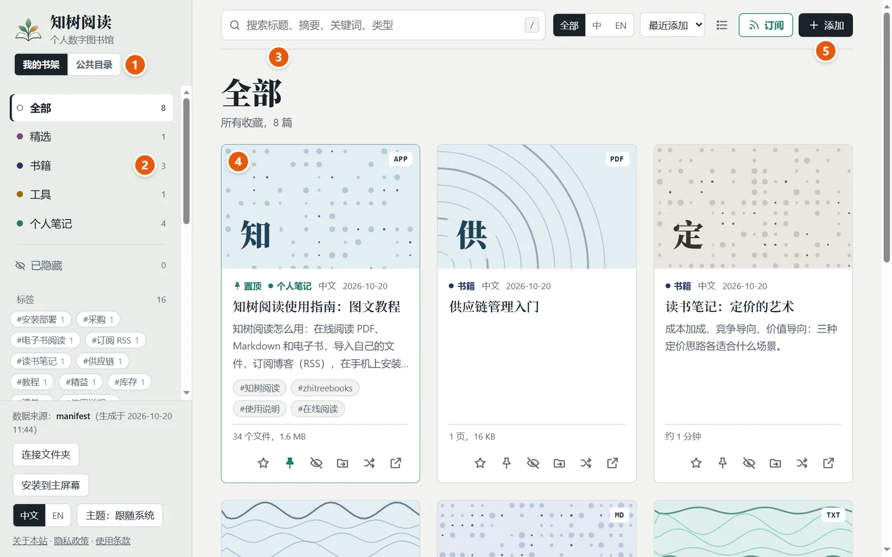

> **带图的在线教程**：网站首页置顶的第一张卡片就是《知树阅读使用指南》（源文件在 `library/notes/guide/`，一个自带“使用说明 / 安装部署”切换标签的页面；有中文和英文两个版本，英文版在 `library/notes/guide/en/`，把界面切到英文就会打开它）。本文是同一份内容的文字版，后面还有全部技术细节。

---

## 使用说明

给读者和使用者：怎么读、怎么存自己的文件、怎么在手机上用、怎么投稿。不用注册，不用登录。

### 1. 认识首页

1. **我的书架 / 公共目录**：两个空间，点一下切换。
2. **分类和标签**：点分类只看这一类，点标签按主题筛选；下面的“卡片目录”列出每类文章的标题，点一下跳到那张卡片。
3. **搜索**：标题、摘要、关键词一起搜，按 `/` 直接跳到搜索框。
4. **卡片**：封面、标题、摘要、阅读时间，点它开始阅读（右上角的小标记是文件类型，`APP` 是网页小工具）。
5. **添加**：把你自己的文件放进来（见第 4 节）。

搜索框右边还有语言筛选（全部 / 中 / EN）、排序（最近添加 / 最近阅读 / 标题）、列表 / 卡片视图、订阅；左下角切换界面语言（**自动**（默认，跟随系统，系统语言改了页面也跟着改）加一个“中 / EN”按钮，点一下换成另一种，就当成你的选择）和主题（跟随系统 / 浅色 / 深色）。

### 2. 读一篇

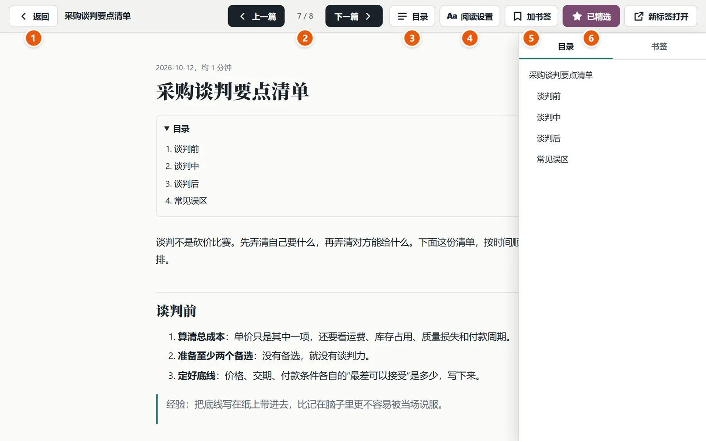

顶栏从左到右：**返回**、**上一篇 / 下一篇**、**目录**（取文章里的标题，右边还有“书签”页）、**阅读设置（Aa）**、**加书签**、**精选**、**新标签打开**。滚动时自动记住进度，首页的“继续阅读”列出读到一半的几篇。快捷键：`Esc` 关闭，`←` `→` 翻页。

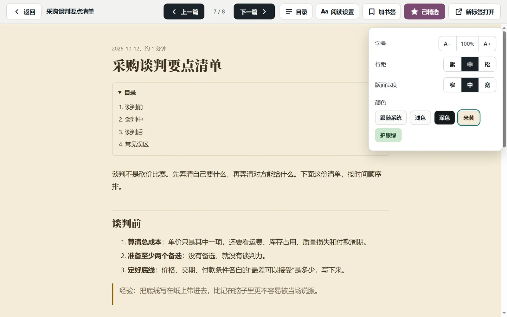

阅读颜色有“跟随系统 / 浅色 / 深色 / 米黄 / 护眼绿”；Markdown 和 TXT 还能调字号、行距、版面宽度。HTML 和 PDF 保持原样，只能换颜色（PDF 没有目录和书签）。

### 3. 卡片上的按钮

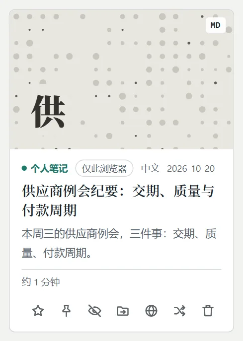

| 按钮 | 作用 |
| --- | --- |
| 星标 | 设为精选，收进“精选”分类 |
| 图钉 | **置顶**：排在最前面，带“置顶”标记；多篇置顶时最后置的排最前 |
| 眼睛 | 隐藏：从分类和搜索里拿掉，不删文件；左侧“已隐藏”里恢复 |
| 文件夹箭头 | 移到其他分类（你自己的文件还能换合集） |
| 地球 | 把这一项送去公共目录审核（站点开通了才有） |
| 交叉箭头 | 换一张封面 |
| 外链箭头 | 新标签打开（站点上的卡片） |
| 垃圾桶 | **删除**，只有你自己的文件才有，会先确认，删了找不回来 |

**站点自己的书访客删不了**：卡片上没有垃圾桶，网站也没有任何“删除”请求可调用；只有站长在自己电脑的 `library/` 里删，再重新部署。访客在线上点的星标、置顶、隐藏、移动分类，只保存在他自己的浏览器里，不影响别人。

### 4. 放进你自己的文件，用合集分组

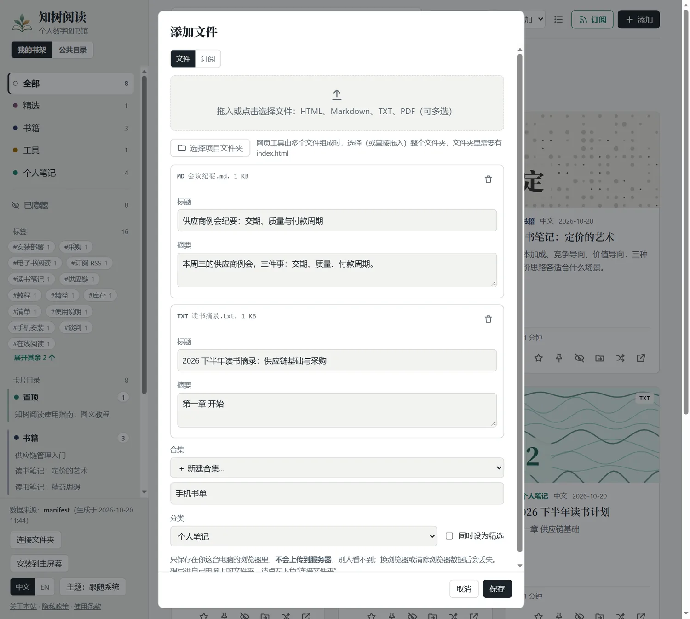

点“添加”（或把文件拖进页面）→ **一次可以选很多个** HTML / Markdown / TXT / PDF（单个不超过 30 MB）→ 选好合集和分类 → 保存。它们只存在**你这个浏览器**里，不会上传，别人看不到；换浏览器、换设备或清除网站数据就没有了，手机和电脑之间**不同步**。想长期放在自己电脑上，用左下角的“连接文件夹”（Chrome / Edge）。

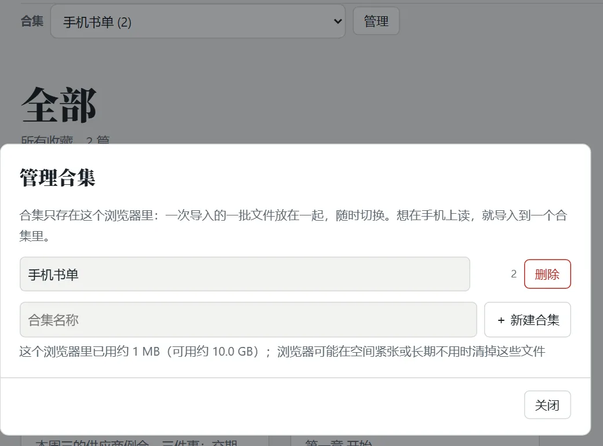

一次导入的一批文件可以放进一个**合集**。选中一个合集后，卡片、分类、标签、搜索、“继续阅读”都只显示这个合集。电脑上用页面上方的“合集”下拉框，手机上在左侧目录最上面。“管理”里可以新建、改名、删除（删除合集会连里面的文件一起删，会先问）。

#### 写笔记（手机像备忘录，电脑是 Markdown）

电脑上点顶栏的铅笔，手机上点右下角的圆形铅笔按钮（“添加”窗口里的“写一篇笔记”也一样），打开一个整页的编辑器。**笔记就是书架里的一篇 Markdown 文章**（类型 `md`，存在这个浏览器里，和“仅此浏览器”的文件一样），所以卡片、阅读器、搜索、备份、同步都照常用。编辑器有两种方式，右下/工具栏里可以随时切换，选择记在这个浏览器里：

- **文档编辑**（手机和触屏默认，像苹果备忘录）：所见即所得，**文字输入交给浏览器自己**（`contenteditable`：系统键盘、光标、选区放大镜、听写、自动更正、撤销都是原生的）；第一行就是标题（放大显示）。键盘上方一排：`Aa`（标题 / 小标题 / 正文 / 粗体 / 斜体 / 删除线 / 引用 / 编号列表 / MD）、待办（圆圈，**点一下打勾**）、列表、链接、图片链接、撤销、重做。行首打 `- `、`1. `、`# `（`##`）、`[] `、`> ` 再按空格，自动变成列表、编号、标题、待办、引用；回车接着写下一项，空的一项再回车结束列表。**贴文字只带文字**（不带别处的颜色字体），贴一个网址变成链接，贴图片地址（`.png/.jpg/.gif/.webp…`）变成图片；链接和图片用键盘上方的小面板输入（地址栏用网址键盘，没写 `https://` 会补上；图片只能是 https 链接）。**图片只是链接，不存图片文件**（备份、同步、体积都不受影响），贴图片文件会提醒改贴链接。
- **Markdown**（电脑默认）：下面这些。
- **底下仍是 Markdown**：文档编辑用一个小的序列化器写回 Markdown（标题、粗体、斜体、删除线、行内代码、链接、图片、引用、代码块、分隔线、编号 / 无序 / 嵌套列表、待办），用 `marked` + DOMPurify 读入；**写成了文档表示不了的笔记（表格、网页代码、头部信息 front matter、`http://` 图片、`mailto:` 链接……）不会在文档模式里打开**：每次打开先把 Markdown 读成文档、再写回 Markdown，两次渲染结果不一样就改用 Markdown 打开并说明，所以不会丢任何东西。
- **边写边存**：停笔 0.7 秒后自动存；标题不填就取第一行；正文里的 `#标签` 成为笔记的关键词；没写任何内容就关掉，不会留下空笔记。返回键、Esc、“完成”都会先存再关。
- **工具栏**：标题（再点一次换级别：`##` → `###` → 无）、加粗、斜体、删除线、引用、列表、编号、待办、代码（多行是代码块）、链接、分隔线、撤销、重做；快捷键 Ctrl/⌘+B、I、K、S。工具栏用 `execCommand` 改文字，浏览器自己的撤销照常可用。**列表里按回车**接着下一项（编号、待办也一样），空的一项再按回车结束列表；列表里 Tab / Shift+Tab 缩进。
- **预览**：宽屏（≥ 1000px）右边实时显示；窄一点和手机点“预览”切换，预览放在一个不允许脚本的文档里，用的是和阅读器同一个渲染。
- **手机**：编辑器随浏览器的可视区域（`visualViewport`）收缩，键盘弹出时工具栏在键盘上方，点工具栏按钮不会收起键盘；工具按钮高度 40px。
- **再次编辑**：自己的 Markdown 笔记和导入的 `.md`（存在浏览器里的）卡片上有铅笔（手机上在“…”里），阅读页顶栏也有；站点自带的、`serve.py` 文件夹里的、连接的本机文件夹里的文件不能在这里改。
- **同步**：在一台设备上改过的文字，另一台下次同步时取回新文字（同步用文字的内容算钥匙，钥匙变了就知道文字变了）。

#### 订阅别人的博客和文章源

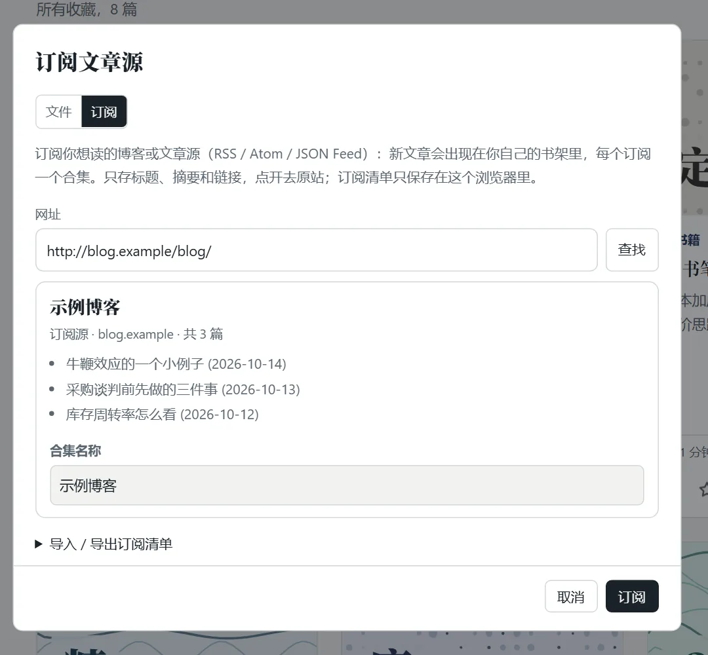

“添加”窗口的第二个标签 **订阅**：贴一个博客首页或订阅源（RSS / Atom / JSON Feed）→ “查找”（显示名字和最近几篇）→ 起个合集名 → 订阅。**每个订阅是一个合集**，新文章出现在里面，带“新”标记，合集旁边显示有几篇新的；点文章在阅读器里读。

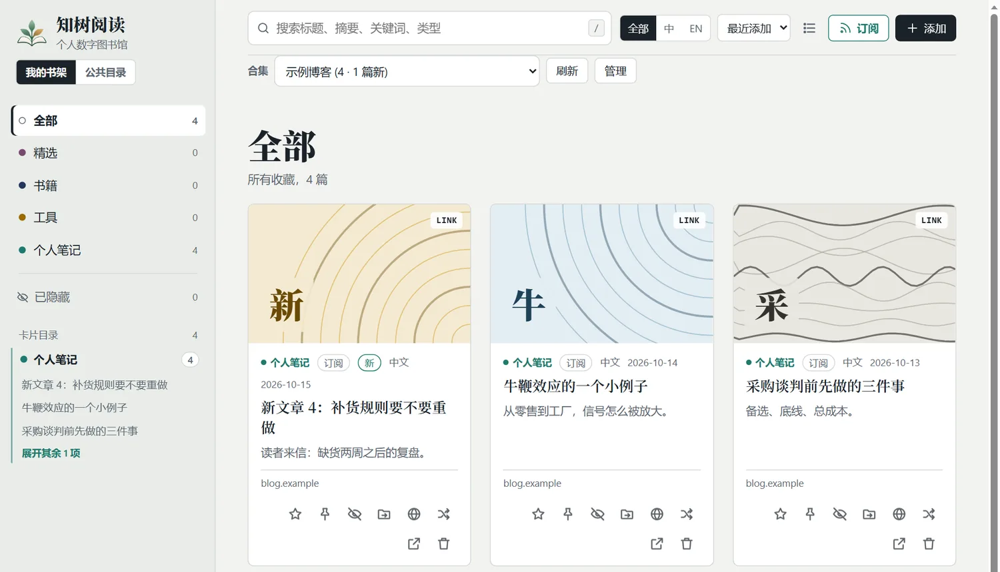

- **订阅源自带全文时，最近的 12 篇会带上正文**（每篇限 6 万字符，一次回答总共限约 150 万字符；只带摘要的源、不够 500 字的描述，不当作正文），页面保存最近 30 篇的正文，卡片上有“全文”标记，点开在阅读器里读（阅读设置里可以改字号、颜色，也可以“下载网页（HTML）”或“打印 / 存为 PDF”），顶栏和文末都有“阅读原文”。和收藏的链接一样可以搜索、加星、置顶、隐藏、删除（删掉的那一篇下次更新不会再出现）。每个订阅保留最近 60 篇，加了星或置顶的不清。正文都是更新服务重建成的一个很小的安全子集（只留文字、图片、链接和常见排版，不留脚本、样式、框架、表单），页面显示前再清理一遍，并放进一个不允许任何脚本、不发 referer 的文档里。
- **任何链接都在站内读**：订阅源只带摘要的、你收藏或粘贴的任意文章链接、公共目录里的文章，点开时由更新服务的 `read` 动作去读原文页面，提取正文后显示在阅读器里（慢的页面要十几秒，先显示“正在读取原文…”和一个“打开原文”按钮），正文存在你的浏览器里，下次秒开；订阅的最新 5 篇会在空闲时提前读好。**读不了的**（要登录或付费、人机验证、靠脚本显示正文、PDF、robots.txt 不允许、对方 4xx/5xx）说明原因并打开原文，卡片标“仅原站”（一周后重试）；网络问题不算结论，下次再试。读页面时不带 cookie、不登录、自报家门（`ZhiTreeBooks-Reader/1`），默认遵守对方的 robots.txt。
- **播客和后台播放**：订阅一个播客（贴它的 RSS 地址，和订阅博客一样），订阅源里的每一集除了标题和摘要，还带着**声音的地址、时长和封面**（更新服务只把这些地址交给页面，**不读、不转存任何声音**；长到超过 2 MB 的订阅源读到哪算哪，只留完整的几集，新的在前）。每一集的卡片上有“播客”标记和封面上的**播放键**；**点卡片的标题或封面就播放**（再点暂停；带修饰键的点击仍然打开那一集的页面），节目说明在卡片上的“说明”按钮里。页面底部出现**播放条**（像音乐软件的）：封面、上一集 / 后退 15 秒 / 播放 / 前进 30 秒 / 下一集、可拖动的进度条和两边的时间、倍速按钮（点一下换一档）、音量；点封面打开**“正在播放”页**：节目说明、倍速 0.75×–2×、定时关闭（15 / 30 / 60 分钟、本集结束）、播放列表（一集放完自动放下一集，“加入播放列表”在每一集的按钮里）。**播放条可以收起**：条上边缘有个小标签（或在条上向下滑），点一下收成角落里的圆形小按钮（封面 + 播放 / 暂停，两个都是 44px 并隔开，手机上不容易误触），点封面再展开；条上没有“关闭”键，真要关在“正在播放”页的“关闭播放器”里。读文章时它自己收起、读完自己展开，暂停 5 分钟后也自己收起（声音不断）；手动收起的状态记在 `archive.plMini`。**“推荐订阅”里的播客有“试听”按钮**：不用订阅，更新服务读出最新一集的声音地址，页面就播放它（用 `recommended.json` 里分组的 `podcast: true`）；**公共目录里带声音的内容**（`directory.json` 的条目有 `audio`）点一下也播放，收藏成书签时声音地址一起保存。**阅读器就在同一个页面里**：打开文章、翻页、换书架，声音都不会断（别关页面）；浏览器支持时，锁屏和通知栏也有播放控制（Media Session）。每一集听到哪里、播放列表和倍速只记在这个浏览器里（`archive.pl`、`archive.plProg`），下次打开播放条还在，点播放接着听（页面不能自己开始出声）。声音由节目自己的服务器直接送到你的浏览器（本站和更新服务都不经手、不保存），所以那个服务器能看到你的 IP；http 地址的在 https 页面里先试 https，放不了、或对方不让外站播放时，页面会提示并给“打开原站”。备份与恢复会带上每一集的声音地址。手机后台播放：安卓 Chrome 一般可以；iPhone 上网页和装到主屏幕的网页行为不一样，**没有在真机上验证过**。
- **更新**：打开页面时自动更新（距上次超过 3 小时），或点“刷新”（页面上方、左侧合集列表、合集“管理”里都有）。**网页没法在后台定时更新，所以没有推送**；没有网络时看上次存下的。
- **推荐订阅页**：`recommended.json`（项目根目录，随站点一起发布，站长手工维护）列出一百个左右的博客和栏目：`groups[]`（`id`、`zh`、`en`）里的 `items[]`（`id`、`name`、`name_en`、`zh`、`en`、`home`、`feed`、`lang`、`tags`、`tags_en`、`rank`、`full`、`starter`）。页面左侧列表多一项“推荐订阅”（地址后面加 `#recommend` 也能直达；没有订阅时全部页顶有一条可关闭的提示），每类里按 `rank`（流量参考，Tranco 全球排名，越小越大；没有的排最后；公司博客挂在母域名下的不填）从大到小排。每行两个勾：**订阅**（一次订好几个：每个一个合集，第一批文章马上读取，最多 30 个订阅）和**推送审核**（用公共目录的提交服务，每个源一条 `kind:url` 申请，需要勾一次“我推荐它们收录”的声明；已在目录里的、已经推送过的显示为已选）。`starter: true` 的会同时出现在“添加 → 订阅”窗口的“试试这些”里。语言筛选和搜索框对这一页同样有效；没有目录服务（`submit_api`）或没有这个文件时，入口和提示都不出现。**`feed` 也可以写 `hot:<榜单编号>`**（如 `hot:github`、`hot:bilibili`、`hot:netease`）：那是目录服务自己的热榜（`/api/hot`，见 `shelf-directory` 的 README）。页面先问服务有哪些榜（`GET /api/hot`），只显示服务提供的（站长关掉的榜不出现；服务连不上时所有热榜都不出现），订阅后的合集每次更新就是平台当前的榜单；热榜只能订阅，不能“推送审核”。现在文件的第一组“热榜与趋势”就是这样：7 个服务自己的热榜（GitHub、掘金、V2EX、B 站、网易云、知乎、微博），加上 Hacker News、Product Hunt、Reddit、Lobsters 和金融（CNBC）、学术（Science、Nature、ScienceDaily）、音乐（Pitchfork、Bandcamp Daily）的公开订阅源。批量推送要放宽提交服务的每日上限：在目录项目的 Vercel 环境变量里加 `SUBMIT_PER_DAY`（默认 5，最大 500）和 `SUBMIT_MAX_OPEN`（待审队列，默认 100，最大 1000）。
- **试试这些**：公共目录里被站长标成“新读者可订阅”的订阅源（`registry/shelves.json` 里该条有 `"starter": true`，或用 `python aggregate.py approve 网址 --starter` 登记），会在“添加 → 订阅”窗口里列成一排，每条一个“订阅”按钮，点一下就订阅（直接按目录里记的订阅源地址，不再查找一遍）并立刻读第一批文章；可以连着点几个，点“完成”回到书架。最多 16 个，读者的界面语言排前面；没有这样的源或没开通目录时这一块不出现。
- **贴的是一篇文章**（没有订阅源）：只能存成一条链接，不会更新；读得了的话正文一起存下来。
- **换设备**：合集“管理”（或添加窗口的“导入 / 导出订阅清单”）里导出 OPML、或复制“清单链接”（网址放在 `#` 后面），到另一台设备导入或打开。**只同步订阅清单**，文章和已读状态各设备自己更新。OPML 也能和 Feedly 等阅读器互通。上限 30 个订阅。
- **隐私**：别人的网站不让网页直接读，所以由目录项目的“更新服务”`/api/feed` 代读：你订阅的网址、点开的文章网址会发给它，它读完把标题、摘要和正文还给浏览器，**自己什么都不保存**（见隐私政策）。没开通目录和提交服务的站点没有这个标签。

### 5. 在手机上用

- **装到主屏幕**：Android Chrome 点左侧栏底部的“安装到主屏幕”（或菜单里的“添加到主屏幕”）；iPhone Safari 点“分享 → 添加到主屏幕”。装好后全屏打开，打开过的页面和文件（最多 120 个）**没有网络也能读**。**iPhone 一定要装到主屏幕再用**，否则 Safari 约 7 天不用就会清掉你添加的文件和进度。
- **左侧目录**：点左上角的 `≡`，最上面是合集，然后是分类、标签、卡片目录。**把目录里的一条往左滑**：你自己的文件露出红色“删除”，站点上的书露出灰色“隐藏”（在“已隐藏”里则是“恢复”）。
- **分享到知树阅读（Android）**：装好后在文件管理器、微信、浏览器里点“分享”，选“知树阅读”，文件会打开“添加”窗口，网址会存成“收藏的链接”。iPhone 没有这个入口，用“添加”多选文件。
- **备份与恢复**：左下角的“备份与恢复”可以把这个浏览器里的东西导出成一个 .zip（完整备份：你添加的文件、合集、订阅、收藏的链接、阅读进度、书签、星标和设置），或一个很小的 .json（只有书单和设置，不含文件内容）；恢复时先显示备份里有什么、哪些已经在这里，点“合并”才导入，**只合并、不删除现有内容**，内容相同的文件不重复。备份由浏览器生成、保存在你自己的设备上，不经过服务器。站点自带的书和连接的本机文件夹里的文件不在备份里。
- **同步（可选）**：站点开通同步服务时，左下角有“同步”按钮。第一台设备点“开启同步，生成同步码”并保存好同步码，另一台设备输入同步码“连接”；之后改动几秒后自动同步（回到页面时也同步一次）。**同步书单、收藏的链接、订阅清单、合集、阅读进度、书签、星标和置顶；体积小的文本文件（Markdown / TXT / HTML，单个约 1 MB 以内）连内容同步，在别的设备上打开时才取回，最近 8 篇会提前取回；PDF 等大文件只同步书单**（卡片上标“仅书单”，要带过去用“备份与恢复”）；订阅里的文章不同步（各设备自己从订阅源读）。加密在浏览器里完成（AES-GCM，钥匙由同步码算出），同步服务读不了任何内容，同步码丢了无法找回；免费空间约 9 MB，半年不用清掉；两边同时改同一处时，进度取较新的、书签合并、其余以正在用的这台为准，一边删除一边改动的保留改动；断网、空间已满、同步空间过期（会用本机现有内容重建，不删任何东西）都有提示。用满 20 分钟（只算页面在前台且有操作的时间）后会问一次“如果以后有大文件同步，愿意付费吗”，回答只作为匿名计数发给同步服务。
- **阅读器顶栏**：返回、上一篇 / 下一篇、目录、阅读设置、**保存**（下载网页 HTML / 打印·存为 PDF；PDF 本身用浏览器的功能保存，按钮置灰）、加书签、精选、新标签打开。手机上目录面板最宽占屏幕的 78%，面板打开时空出来的部分是一层可点的底（点一下收回；目录面板向右滑也收回），左侧列表同样（宽度最多 80%，旁边是真正的遮罩，点一下收回，不会点到下面的卡片）；桌面上没有这层底，面板打开时文章照常可以滚动。
- **排序**：最近添加 / 发布日期 / 最近阅读 / 标题。公共目录里是 最新发布 / 热度 / 最近阅读（在这里打开过的，只记在你的浏览器里）/ 标题；“热度”要目录开通了匿名计数（见下面“公共目录”）才有。
- **手机**：卡片视图两列，卡片上除星标外的按钮收在“…”里（列表视图仍是一列、按钮都在）；读文章时向左 / 向右滑 = 下一篇 / 上一篇（读的是页面里的文档；PDF 这类滑不动的文件，目录面板里留着上一篇 / 下一篇按钮），书架上向右滑打开左侧列表、向左滑收起。手势排除了：会横向滚动的代码块和表格、选中了文字、放大了页面、距屏幕边缘 20px 以内（系统返回手势）、多指；读者页面带 `touch-action: pan-y pinch-zoom` 和 `overscroll-behavior-x: none`，浏览器自己的“横滑返回”不会抢走手势。
- **这是什么**：第一次打开首页会弹出一个说明窗口（只一次），回答“这是什么、东西存在哪、公开还是私有、不是什么”；之后在左下角点“这是什么”再看。**有更新时**，下次打开会弹出一次“更新说明”。发布新版本时在 `index.html` 里同时改 `APP_VERSION` 和 `CHANGELOG`（日期大的在前，中英文各写几条）。

<p align="center">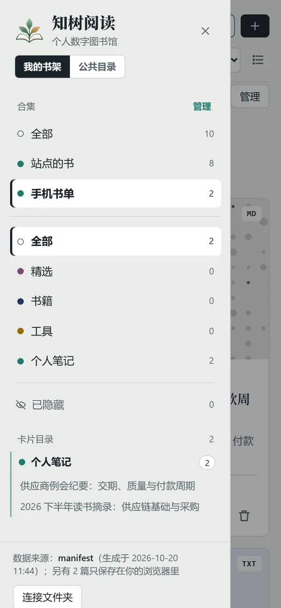 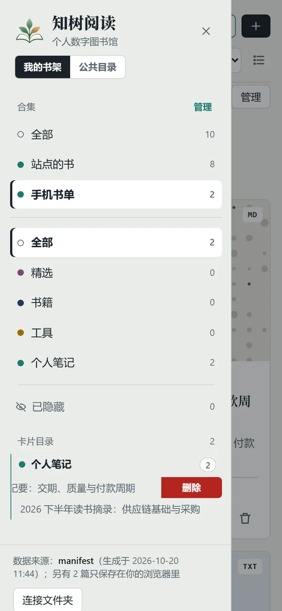 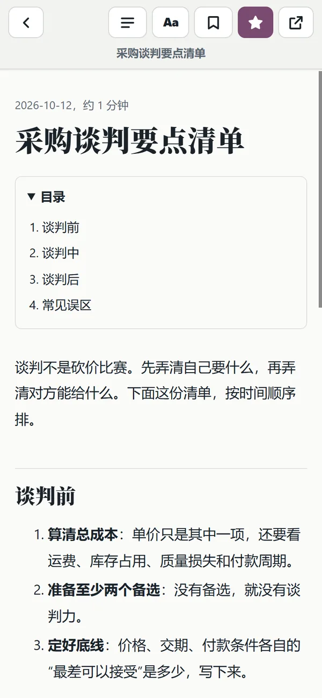</p>

### 6. 公共目录与投稿

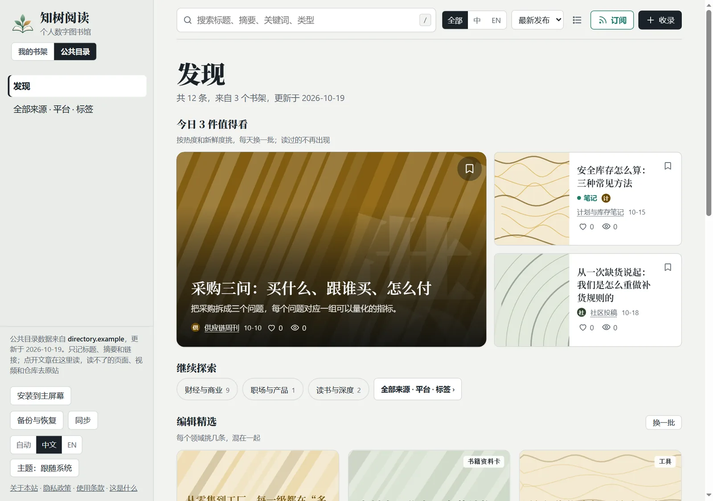

“公共目录”把很多人的博客、文章、GitHub 仓库、视频汇成一份目录，**只记标题、摘要、封面图地址和回原站的链接**，点击都去原站。可以按类型、标签、书架筛选和搜索；卡片上的书签把链接收藏进你自己的书架；顶栏“订阅”订阅整个目录、某个类型、标签或书架。

公共目录分两层。**第一层是发现页**（下面“首页”一段）：没有工具栏，也没有标签和书架列表，只有今天值得看的内容、一行栏目入口（每个栏目带篇数）和一个“**全部来源 · 平台 · 标签 ›**”按钮；点一个栏目、搜索，或点这个按钮，进入**第二层——整个目录**，侧栏里“发现”和“全部 / 文章 / 音频 …”**并排**（两层都在）：点“发现”回来，点“全部”或某个类型就看整个目录里的那一类；离开公共目录再回来，又从发现页开始。第二层的布局是：标题下面是“**栏目 | 平台**”两个标签页（标签会自动换行，不会横向滚动）。**栏目**一侧是 8 个栏目：**今日摸鱼、AI 与科技、学习与研究、财经与商业（供应链在里面）、职场与产品、视频与创作者、读书与深度、全球正在发生**，有内容的才显示。**一篇内容只属于一个栏目**：先看平台和类型（YouTube、B 站、视频归“视频与创作者”），再看它自己的第一个领域（领域＝科技、编程、金融、供应链……共 17 个，每一篇按它自己的标题、标签和摘要归类，节目的标签只是起点）。点进一个栏目，下面多出一行它里面的领域（比如“AI 与科技”里有 科技 / 编程），再点就只看那一个。这 8 个栏目是页面里内置的；目录服务的 `directory.json` 里写了 `columns` 就按它的来，某个来源写了 `topics` / `platform` 就不再靠猜。**平台**一侧：**平台**一侧列出所有有节目的平台（知乎、微博、微信公众号、B 站、YouTube、GitHub、掘金、V2EX、Reddit、Hacker News……，按节目的网址判断，目录自己的热榜按它读的那个平台算；名字超过 7 个字就截成 6 个字加“…”，完整名字在提示里），先是**固定平台**（按网址认出来的，节目多的在前），再是**动态平台**：每个独立网站（订阅源、仓库）自己算一个平台，当前最忙的 5 个（热度、节目篇数、你读过的）先显示，其余收在最后的“更多 N ▾”里，点一下展开；读者贴来的单条链接归“其他”。**两侧都有一个下拉按钮（同一个位置，同一个面板）**：**平台一侧是“节目”**，列出当前平台下的**每一个订阅节目**（没选平台时按平台分组），可搜索、**多选**；勾选的节目保存在这个浏览器里，之后平台标签页就**只显示这些节目**（标题下有“已选 N 个节目 ✕”，一点清除）。**栏目一侧是“栏目”**，列出有文章的栏目（每一行写着有几篇，篇数多的在前），同样可搜索、**多选**；勾选的栏目也保存在这个浏览器里（以前版本勾选的领域会自动换成它所在的栏目），之后栏目一侧就**只显示这些栏目里的文章**，上面的标签也只剩勾选的几个（“已选 N 个栏目 ✕”一点清除）。两侧各记各的勾选，切到另一侧时不生效。面板里还有“站长推荐 / 热门 / 我订阅的”几个快捷筛选。上次停在领域还是平台一侧，刷新后还停在那一侧。手机上领域标签只显示两排（有第三排时才折起），其余在“更多”后面（点开某个领域就全部展开）；英文界面里领域名是完整的单词，平台名才截到 7 个字。

**首页**（不选标签、不搜索时）像一份“今天值得看”的内容流，没有横向滚动的行。**第一次来**（还没选过）最上面是一张“**现在想看什么？**”：四种心情（摸鱼一下、学习进阶、看懂热点、深度收藏），点一个就替你勾上对应的栏目，也可以自己点几个栏目再点“看这几个栏目”，“先随便看看”就不再问；**只有你主动点了才会记，页面不会替你猜**，之后随时可以在“栏目”下拉里改。**勾选了栏目以后，首页就是你自己的首页**：每个勾选的栏目一小节（3 张卡加“更多 ›”，点进去就是那个栏目），“精选”一节让位给它们。**隔了 30 天以上再来**，今日之后多一节“**你可能错过了**”（这段时间最新的几篇，写明隔了多少天）；读过东西以后还有“**最近读过**”（最近打开的三篇）。进了栏目、领域、平台或搜索以后，标题下有一行“你在哪”（栏目：AI 与科技 ✕、领域：编程 ✕ ……），点侧栏的“发现”一下清掉所有筛选回到发现页（勾选的栏目保留）。从上到下是：**今日 3 件值得看**（一张大图卡，图上直接放标题，旁边两张小卡；每个节目最多一篇，按热度、新鲜度、有没有图和像样的摘要来挑，同一天里近似的由日期决定先后，所以每天换一批；读过的、点了“不喜欢”的不再出现；点了收藏不会让它们换位置）→ **编辑精选**（读过东西以后叫“为你精选”；图文卡，小红书的样子，排成整齐的网格——**最多 3 列，手机 2 列，更多的列看不过来**；每张卡的封面一样大，同一行的卡片等高、底边对齐：每个领域或平台挑几条轮流混在一起，同一个节目最多 2 条；这个浏览器里读过、收藏、订阅、点过喜欢的内容多于 3 条时，同一个流会按你的兴趣排序，并说明“数据不离开你的设备”，旁边有一键清除；“换一批”换下一组；一共 6 张，正好是 2 整行或 3 整行，不会留一截空白）→ **值得订阅**（站长推荐的节目，不够 3 个时用最近最热的补，已经订阅的不再出现）→ **最新更新**（同样的网格，上面已经出现过的不再重复；设了别的排序，标题就改成“全部内容”）。**工具栏上的“卡片 / 列表”按钮在哪里都有效（手机上也有）**：默认是网格，点一下，精选和最新就都变成一行一条的列表（小封面、标题、两行摘要、一行来源和数字、收藏书签，够宽时分两栏），再点回来；选择记在浏览器里。排序分 = 热度（取对数）+ 新鲜度（约 3 天减半）+ 站长推荐 + 喜欢 − 不喜欢 + 榜单名次，没有计数时只靠新鲜度和站长推荐，不会空；**界面是什么语言，那个语言的内容就多加一点分，同一天里也排在前面**（中文界面里中文内容先出来，英文不会被藏起来；想只看一种语言，用右上的“中 / EN”筛选）。**一张卡的样子**（网格里）：先是封面，再是标题（最多两行）、摘要（两行）、最多两个标签、来源（以节目命名的小圆标 + 名字 + 日期）、最底下一行是 ♥ 喜欢数（点一下就喜欢，再点取消）、👁 阅读数、🔥 热度和收藏书签；有计数服务时每张卡有这几个数字（**数字是 0 就不显示**，♥ 按钮一直在），没有时只有 ♥（没有数字）。每张卡**最多一个“为什么值得看”的小标签**，只用真实的信号（热榜第 N 名、本周热读、因为你常看 · 某个节目、N 人喜欢、N 次阅读、站长推荐、你订阅的；没有就不写，不会编一个理由）；文章不再标“文章”（视频、书籍等才标类型），语言只在和页面语言不同时才标（EN / 中文），日期是“今天 / 昨天 / 10-22”，摘要不重复标题，没有“打开原文”箭头（点标题或封面就是打开）。**封面**：有图的用文章自己的图（统一裁成同一个形状）；**没有图的，封面上写着摘要的开头**（像一张文字海报：以节目的颜色做底，图案每篇不同，同一个节目的颜色始终一样，所以这一栏的字不会在卡片下面再写一遍）；没有摘要的用节目的首字做大字，热榜条目把名次做成封面上的大数字；图片加载失败时自动换成这种封面。在阅读目录里的文章时，阅读页底部也有喜欢 / 不喜欢两个按钮。**手机上**首屏是一张大卡和两条，下面是两列的网格（卡片上不放标签；有图的卡片在标题下留两行摘要，没图的摘要就在封面上；收藏按钮不小于 44px），点“列表”就是一列紧凑的行（一行摘要、数字都在）。

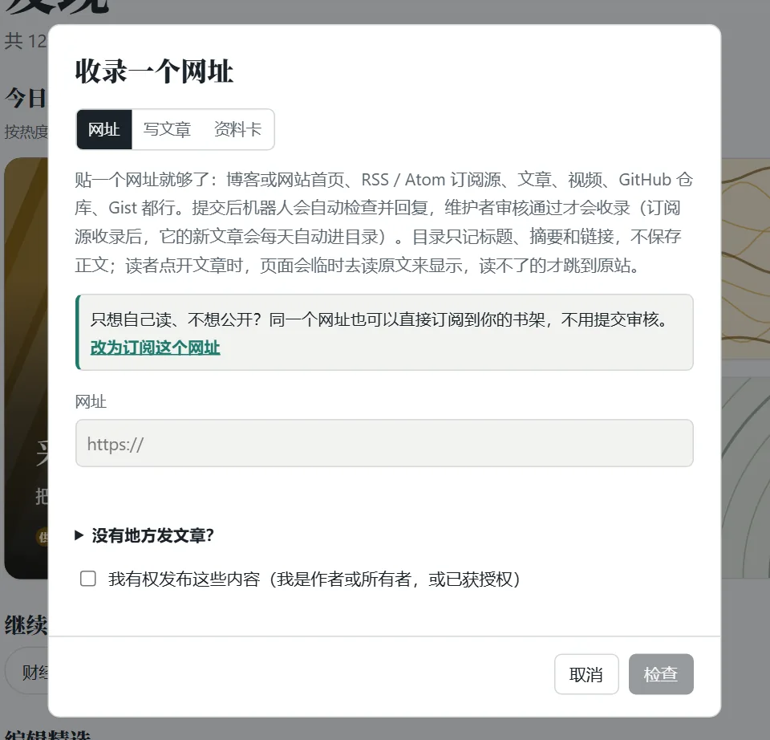

**精选图书**：目录里有一个站长手挑的书架（侧栏“精选图书”），收的都是谁都能免费读的书和刊物——公有领域的名著（红楼梦、福尔摩斯、傲慢与偏见……）、过刊（科学杂志、新青年）、开放获取的期刊和教材（SICP、Pro Git、eLife、OpenStax），每本标着授权。书单由 `shelf-directory` 的 `registry/books.json` 维护（见那边的 README B6b）。点一本有章节的书，弹出“书的窗口”：简介、授权、章节按钮、“从头开始读 / 继续读：某章”、“打开原站”；点一章在阅读器里读（和读任何文章一样：字号、颜色都能调），顶栏“上一篇 / 下一篇”翻章，关掉阅读页回到章节表；这个浏览器记住读到哪一章。只有一页的书直接在阅读器里读，别的书在原站打开。需要更新服务（`/api/feed`）；没有时都在原站打开。测试：`devtools/e2e/tests/s_books.js`。

**投稿不需要账号，三种方式**：① 点“收录”贴一个网址 → “检查”（会告诉你它是什么、找到几篇，并先拦下目录里已有的）→ 勾选声明 → 提交；② 在“收录”里切到“写文章”，由目录托管成一个公开页面（不显示图片，可要求下架）；③ 点“我的书架”卡片上的地球图标（有网址的送网址，Markdown / TXT 送正文，书 / PDF / 工具只送一张书籍卡片）。提交后进站长的审核队列，通过后出现在目录里。别贴 `…/#read/…` 这种阅读器地址，那只有你自己的浏览器打得开。

### 7. 订阅本站（RSS）

点顶栏的“订阅”（订阅**这个网站**，用你自己的 RSS 阅读器读；订阅别人的文章见上面第 4 节）：有“在 Feedly / Inoreader 中订阅”的一键链接和复制按钮，可以只订阅全部、某个分类或某个标签。

下面几节是同一部分的详细说明（访客的本地使用、格式、阅读体验、手机安装的细节）。


### 详细说明：访问者的本地使用（部署的站点上，或不开 `serve.py` 时）


页面上显示的是三份内容**并排**，互不替换：服务器自己的列表、访问者自己连接的本机文件夹、访问者在浏览器里添加的文件。后两份卡片上会标出“本机文件夹”“仅此浏览器”，**只存在访问者自己的电脑上，不会上传到服务器，别人也看不到**。

- **连接文件夹**（Chrome / Edge，左下角）：选自己电脑上的一个文件夹（选 `library` 或包含 `books/ tools/ notes/` 的目录），里面的文件就和服务器的列表一起显示。连接后“添加”写进这个文件夹，星标 / 隐藏写进它的 `_meta.json`。“更换本机文件夹”“断开”在同一处。
- **添加文件（可以一次多选）**：没连接文件夹时，“添加”把文件存在这个浏览器里（上限 30 MB 一个）；换浏览器或清除浏览器数据会丢失。这些文件可以改分类，也可以直接点卡片上的垃圾桶删除（删除前会确认）。
- **合集（在手机上读，就导入到一个合集里）**：添加时可以选“放进哪个合集”：新建一个（第一次添加会自动建，默认叫“我的合集”，可以改名）、放进已有的，或不放进合集。添加完页面自动切到这个合集。页面上方出现“合集：全部 / 站点的书 / 你的各个合集 ▼”；**手机上点左上角的目录按钮，左侧列表最上面也有一份“合集”列表**（带数量，当前的高亮，旁边有“管理”），点一个就切换并收起列表。**选中一个以后，卡片、侧栏分类、标签、搜索、“继续阅读”都只显示这个合集**，这样手机上可以只留一个干净的书架。“管理”里可以新建、改名、删除合集（删除会连里面的文件一起删，要确认），并显示这个浏览器里已用的存储空间；卡片上的“移到其他分类”里还可以把某个文件放进别的合集。合集只存在这个浏览器里，不会上传，也不会同步到别的设备；导入的是**复制**，原文件改了要重新导入。
- **分享到知树阅读（Android）**：把站点装到主屏幕后，在文件管理器、微信、浏览器里点“分享”，选“知树阅读”：分享的 PDF / Markdown / TXT / HTML 文件会打开“添加”窗口，选好合集点保存；分享的**网页地址**直接存成“收藏的链接”（放进当前显示的合集）。装好之后要等浏览器更新应用信息（通常一天内，重装主屏幕图标会立刻生效）才会出现在分享列表里。iPhone 的 Safari 不支持这个，用“添加”多选文件（在“文件”App 里选“全选”就等于导入整个文件夹）。分享的文件在你点保存之前只放在这个浏览器的临时缓存里，不会发到任何服务器。
- 用 `serve.py` 时不显示“连接文件夹”：那时 `library/` 本来就是你自己的文件夹，“添加”直接写进去。
- 限制：本机文件夹和浏览器里的内容读不到工具（多文件网页）的 css / js，也不能添加项目文件夹，这需要 `serve.py`。双击打开 `index.html` 时，没连接文件夹就读不了 Markdown / TXT（浏览器限制）。

### 详细说明：支持的格式


| 格式 | 标题 | 摘要 | 阅读方式 |
| --- | --- | --- | --- |
| HTML | `<title>` | description 或导语段落 | 保留原网页的设计（只能换颜色；标题规范的页面有目录和书签） |
| Markdown | front matter 或第一个 `#` 标题 | front matter 或第一段 | 统一排版，字号 / 行距 / 宽度 / 颜色可调，有目录和书签；三个以上小标题时文章开头还有一份目录 |
| TXT | 第一行 | 后面的文字 | 统一排版，同上；以“第三章”“第12回”“Chapter 4”开头的短行（至少两处）当作章节标题，生成目录 |
| PDF | 文档属性里的标题，否则文件名 | 添加时手动填；转换后取第一段正文 | 转换过的（`build_index.py --convert`）：当文章读，有目录、书签、阅读设置，顶栏可切换“原 PDF”；没转换的，或扫描件：浏览器自带的 PDF 阅读器（只能换颜色，没有目录和书签）；手机，或浏览器把 PDF 设成“下载”时，显示“打开 / 下载”按钮 |

单个文件上限 80 MB。Word（.docx）不支持，请另存为 PDF 或 Markdown。

HTML 里可选的 meta：`description`、`keywords`、`archive:category`、`archive:featured`、`archive:cover`、`archive:date`；Markdown 开头可写 front matter（`title`、`description`、`tags`、`featured`）。

### 详细说明：阅读体验


所有格式放进同一个阅读器，顶栏有同一套按钮（手机上更紧凑）：

- **阅读设置（Aa）**：颜色有“跟随系统 / 浅色 / 深色 / 米黄 / 护眼绿”，设置会记住。Markdown 和 TXT 是我们自己排版的，所以还能调**字号、行距、版面宽度**；HTML 和 PDF 按原样显示，只能换颜色（深色是整体反色，米黄 / 护眼绿是盖一层色调），字号请用浏览器自带的缩放。注意这是**换色调**，网页做不到真正的滤蓝光。
- **目录**：Markdown、TXT 和结构规范的 HTML 取它们的标题（h1–h4），点一下跳到那一节，并标出读到哪一节；没有标题的页面显示“没有可用的目录”。**PDF 转成阅读版以后有目录**（取书签，没有书签就取按字号认出的标题）；没转换的 PDF 由浏览器自己显示，没有目录和书签（扫描版没有文字，也转不出来）。手机上点“目录”会从右边滑出，底部有上一篇 / 下一篇。
- **书签**：点“加书签”记下现在读到的位置（同一处再点会替换），在目录面板的“书签”页里点一下回到那里、点 × 删除。书签记的是“读到百分之几 + 最近的标题”，只存在这个浏览器里。书签（记位置）和“设为精选”（收藏整篇）是两回事。
- **进度与继续阅读**：滚动时自动记住进度，下次打开回到那里；首页的“继续阅读”列出读到一半的几篇。
- **分类**：“移动到其他分类”现在在三种情况下都能用：`serve.py` 里真正移动文件；浏览器里添加的文件改分类；**部署的站点和连接的本机文件夹**里，调整只记在这个浏览器里（站点）或这个文件夹的 `_meta.json` 里（文件夹），不会改动网站。
- 所有这些设置、书签、进度都只保存在访问者自己的浏览器里，**不会同步到别的设备**（想要跨设备，只有公共空间能同步，且只同步公开的内容）。

#### 装到手机主屏幕（PWA）

部署的站点可以“安装”：Android Chrome 左侧栏底部会出现“安装到主屏幕”（或用浏览器菜单里的“添加到主屏幕”）；iPhone 在 Safari 里点“分享 → 添加到主屏幕”（页面上的按钮会提示这个步骤）。装好以后全屏打开，像一个 App；打开过的页面和文件（最多 120 个，单个不超过 15 MB，PDF 的分段请求不缓存）会保存在浏览器里，**没有网络也能再读**，首页和阅读器本身也能离线打开。

- **iPhone 一定要装到主屏幕再用**：不装的话，Safari 会在约 7 天不用后清掉这个网站的数据（阅读进度、书签、你添加的文件都会丢），装到主屏幕的不受这个限制。
- 页面第一次访问时会请求“持久存储”，浏览器同意的话数据不会被自动清理。
- `serve.py` 本地预览不注册离线缓存，永远显示文件夹当前的样子。离线缓存的代码在 `sw.js`，图标在 `icons/`，应用信息在 `manifest.webmanifest`；改了 `sw.js` 里的缓存规则后把里面的 `VERSION` 加一，旧的缓存就会清掉。
- 不做小程序和原生 App：手机上浏览器读不了“本机文件夹”（只能一次选几个文件存进浏览器），这是网页的限制；所以手机上用“添加（多选）”和“分享到知树阅读”，把文件放进合集（见上面“访问者的本地使用”）。

### 详细说明：把文件转成阅读版、搜正文（`convert.py`）

PDF 在手机上不好读、也搜不了里面的字。这件事交给**站长在本地转一次**，读和搜都是转出来的静态文件，访问者的浏览器直接读，服务器不做任何计算：

```bash
python build_index.py --convert        # 转换 library/ 里新增、改过的 PDF / Markdown / TXT / HTML（已转过的不重复转）
python build_index.py --convert --force   # 全部重转
python convert.py [--force] [--prune]    # 单独运行（--prune：删掉没有文件再需要的文档包）
```

需要 `pip install pymupdf`（只有转 PDF 才要；没装时 Markdown / TXT / HTML 照转，PDF 保持原样）。每个文件得到一个“文档包” `converted/<sha1 前 12 位>/`：

| 文件 | 内容 | 谁用 |
| --- | --- | --- |
| `doc.json` | 标题、作者、语言、页数、目录、自动摘要、自动关键词、质量分 | 卡片、公共目录的“书籍信息页”、搜索 |
| `text.json` | 每一页（PDF）或每一节（文章）的纯文字 | 我的书架里的“搜正文” |
| `body.html` | PDF 排成能自然换行的文章（段落合并、去掉页眉页脚、按字号认标题） | 阅读器的“阅读版” |

- **转不好就不转**：扫描件（没有文字）、文字质量低于 0.6、正文不足 300 字、超过 4 MB 的，不生成 `body.html`，阅读器照旧显示原 PDF；顶栏的“原 PDF / 阅读版”按钮只在两者都有时出现。表格、图和公式在阅读版里会丢，页码旁的“原 PDF”链接可以直接打开原文件的那一页。
- **不想转的文件**：在 `library/_meta.json` 里写 `"convert": false`（Markdown 在开头写 `convert: false`，HTML 写 `<meta name="archive:convert" content="false">`）。**隐藏的文件、写了 `convert: false` 的文件，不转换也不发布。** 之前转过、后来才隐藏或不想转的，运行 `python convert.py --prune` 会把不再需要的文档包删掉。
- **搜正文只在“我的书架”**：搜索框旁的“搜正文”打开后，先查 `converted/ft.json`（一个很小的字索引，说明哪些文档可能含这个词），再只下载这些文档的 `text.json`，在浏览器里查找；你添加的文本 / 网页文件、连接的文件夹、订阅里保存的文章也一起搜（都在本机）。**公共目录不搜正文**，只搜书籍信息页的内容：标题、作者、语言、页数、目录、摘要、关键词。
- **发布**：`seo.py` 只把“发布出去的条目”的文档包复制进 `dist/converted/`，隐藏条目的不会被复制；`robots.txt` 和响应头都标了 `noindex`，搜索引擎看不到这些文件。订阅源（`feed.json`）会带上作者、页数和目录标题（不带正文），公共目录据此显示和搜索。
- **访问者自己添加的 PDF**：在浏览器里添加（或以前添加、现在才打开）的 PDF，由页面用 pdf.js（`vendor/pdfjs/`，Apache-2.0，约 3 MB，用到时才下载）在**访问者自己的浏览器里**转：阅读版、每页的文字、目录、作者、摘要和关键词，存在这个浏览器里的文件旁边，不上传；之后和站点自己的 PDF 一样可以切换“原 PDF / 阅读版”、可以“搜正文”。扫描件、加密的、超过 60 MB 或 1500 页的保持原 PDF。备份文件不带这些转出来的内容（再打开时重新转）。直接双击打开 `index.html`（`file://`）时浏览器不让加载 pdf.js，这时 PDF 保持原样；用 `serve.py` 或部署的站点都可以。
- **`serve.py`**：启动时、上传文件时（上传在转换完成后才回应，页面马上就看到阅读版；特别大的 PDF 最多等 40 秒，其余在后台继续）、有文件被复制进 `library/` 时，都会自动转；PDF 需要 `pip install pymupdf`（没装会在终端提示一次，PDF 保持原样）。
- 版权：转换只处理你放进 `library/` 的文件；**不要转换、公开你没有权利发布的书**（见“关于、隐私、条款页”）。

### 详细说明：阅读与快捷键


点卡片在站内阅读，顶栏有上一篇 / 下一篇、“设为精选”、“新标签打开”；会记住阅读进度，首页显示“继续阅读”。`/` 聚焦搜索，`Esc` 关闭阅读，阅读时 `←` `→` 切换。卡片上的“隐藏”不删除文件，在左侧最下方的“已隐藏”里可以恢复；要删就点卡片上的垃圾桶（部署的网站上的书访客删不了，只有你在自己电脑上的 `library/` 里能删）。

侧栏的“卡片目录”按分类分块：彩色的分类标题可以点，直接进入该分类；每类默认只列前 3 篇，其余折叠，点“展开其余 N 项”查看、点“收起”折回。关于本站 / 隐私政策 / 使用条款在侧栏最底部。

---

## 安装部署

给站长：怎么在自己电脑上用、怎么部署上线、怎么开通公共目录和审核页。

### 你需要什么

| 要做的事 | 需要 | 必须吗 |
| --- | --- | --- |
| 在自己电脑上用 | Python 3（不用装任何依赖） | 必须 |
| 发布到网上 | Node.js、Vercel 账号（免费的就行） | 想让别人访问就需要 |
| 自己的网址 | 一个域名，在 Vercel 里绑定 | 可选 |
| 公共目录和投稿 | GitHub 账号 | 可选 |

### 速览：三步上线

1. `python serve.py`（Mac / Linux 用 `python3 serve.py`），往 `library/` 里放内容，本地看效果；
2. `npm i -g vercel` → `vercel login` → 在项目文件夹里 `vercel`（第一次创建项目）→ `vercel --prod`；构建命令里的网址（`vercel.json` 的 `--site-url`）换成你自己的；
3. 可选：提交 `sitemap.xml` 给搜索引擎；开通公共目录和审核页（见下）。

想让这篇使用指南排在第一位：在文档开头写 `pinned: true`（Markdown front matter）或 `<meta name="archive:pinned" content="true">`（HTML），重新部署即可；在线上点图钉只对点的人自己有效。

### 审核页：输入密码就能管理

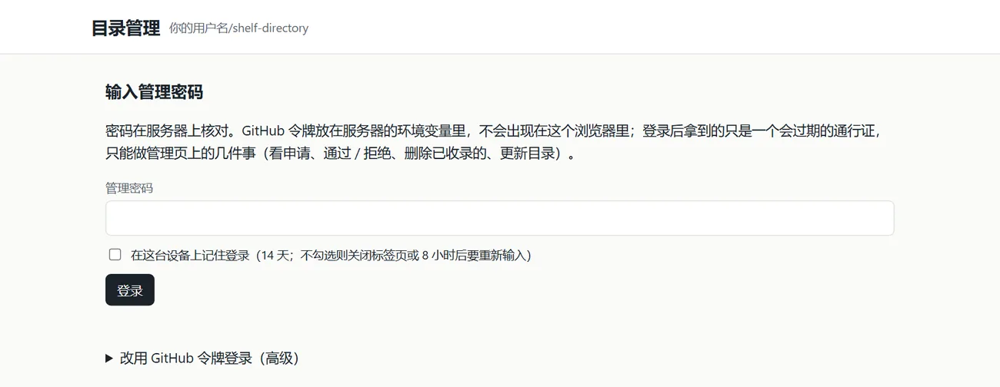

所有申请（GitHub 表单、网页上提交的网址、书架里的文章）都进同一个审核页：公共目录站点的 `/admin/`。在目录项目（`shelf-directory`）的 Vercel 环境变量里加 `ADMIN_PASSWORD`（**至少 12 个字符**）和 `ADMIN_GITHUB_TOKEN`（只选这个仓库：Issues 读写、Actions 读写、Contents 只读，不要和提交用的 `SUBMIT_GITHUB_TOKEN` 共用），重新部署即可。GitHub 令牌只放在服务器里，浏览器拿到的是会过期的通行证；通过 / 拒绝只改仓库里的数据，**不需要重新部署任何站点**。没配密码时页面会说明缺什么，并退回“用 GitHub 令牌登录”。

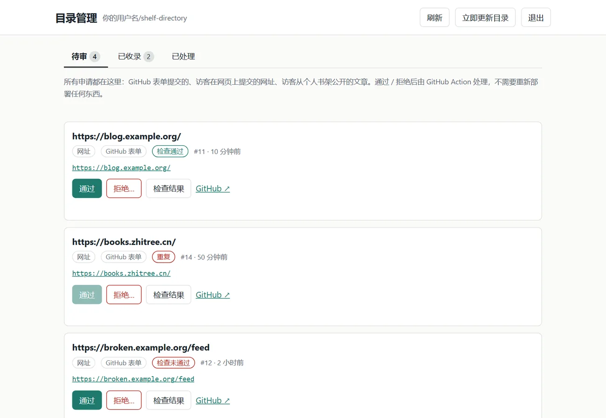


### 把指南发到知乎、小红书（`export_guide.py`）

同一份内容不用重写：`library/notes/guide/index.html` 是唯一的来源，改了文字再运行一次：

```bash
python export_guide.py            # 生成到项目旁边的 ../my-archive-export/（不会放进项目，否则会被部署）
python export_guide.py --no-cards # 不生成小红书卡片
```

需要 `lxml`、`Pillow`；要 Word 文件还要 `pip install python-docx`；小红书卡片用本机的 Edge 或 Chrome 渲染。生成的东西：

| 文件 | 怎么用 |
| --- | --- |
| `使用说明.docx` / `安装部署.docx` | **知乎**：写文章 → “导入文档” → 选这个文件，标题、列表、表格和图片都会带进来，检查一遍再发布 |
| `使用说明.md` / `安装部署.md` + `images/` | 任何 Markdown 编辑器（知乎的导入也认 `.md`，图片要从 `images/` 手动上传） |
| `xiaohongshu/01…08-*.png` + `文案.txt` | **小红书**：发图文笔记，按序号上传 8 张 3:4 卡片，正文粘贴 `文案.txt`（≤ 1000 字，含话题标签） |

图片全部是示例数据的截图（不含真实内容）。各平台的导入功能和发帖规则会变，上传后请先预览；小红书正文里没有放链接（站外链接容易被限流），写的是“搜站名”。

### 本地运行与管理（serve.py）


```bash
python serve.py        # Mac / Linux 用 python3 serve.py
```

浏览器会自动打开 http://127.0.0.1:8000 。就这一条命令：

- **实时扫描 `library/`**：往 `library/books|tools|notes|featured/` 里放文件，刷新页面就出现。
- **添加**：点右上角“添加”，或把文件 / 文件夹拖进页面，直接写入 `library/`。
- **移动分类**：卡片上的文件夹图标，选一个分类（书籍、工具、个人笔记……），文件（工具则是整个文件夹）会真的移到对应的 `library/<分类>/` 里，标题、星标、阅读进度跟着走。重名时自动加 `-2`。
- **删除**：卡片右下角的垃圾桶（点了会先问一次），文件（工具则是整个文件夹）会真的删掉，**无法恢复**；该卡片的阅读进度、书签也一并清掉。不想真删就用旁边的“隐藏”，在左侧“已隐藏”里可以恢复。
- **谁能删什么**：
  - 用 `serve.py` 在自己电脑上打开时，删的是你的 `library/`（只有这台电脑能访问）；要让网站上也消失，删完再 `vercel --prod` 部署一次。
  - 你在这个浏览器里添加的文件、收藏的链接：只存在你的浏览器里，随便删。
  - 你“连接”的本机文件夹里的文件：直接从那个文件夹里删掉（同时清掉它在 `_meta.json` 里的记录）。
  - **部署出来的网站上的书，访客不能删**，卡片上没有垃圾桶，网站也没有任何“删除”请求可调用；访客只能“隐藏”（只在他自己的浏览器里）。除了你本人在自己电脑的 `library/` 里删，没有别的办法。
- **手机上左滑删除**：打开左侧目录列表，把某一条往左滑，下面露出红色“删除”，点它（还会确认一次）就删掉，规则和上面一样；网站上的书（你删不了的）左滑露出的是灰色“隐藏”，在“已隐藏”里则是“恢复”。竖着滑仍然是滚动列表，滑过之后点一下别处会收回去。鼠标不触发，电脑上用卡片上的垃圾桶。
- 移动同理：`serve.py` 的 `library/` 里是真的挪动文件；部署的站点上访客的“移动分类”只保存在他自己的浏览器里。
- **星标、隐藏、改标题** 保存在 `library/_meta.json`。
- **置顶**：卡片上的图钉按钮（星标旁边）。置顶的卡片不管怎么排序、在哪个分类里都排在最前面，带“置顶”标记，左侧目录列表最上面也多出一个“置顶”分组；多篇置顶时，**最后置的排最前**（想让“使用说明”排第一，最后一个置顶它）。**让所有访客都看到的置顶**有两种做法，都要**重新部署**才会上线：① 在你电脑上用 `serve.py` 打开页面点图钉（写进 `library/_meta.json` 的 `"pinned": 置顶时的时间戳`；`serve.py` 要用新版本，旧的会提示“还是旧版本，没有保存置顶”，关掉重开即可）；② 在文档自己开头写：Markdown 的 front matter 里加 `pinned: true`，HTML 里加 `<meta name="archive:pinned" content="true">`（写数字也行，越大越靠前；页面里点的置顶排在它前面，页面里取消置顶则压过它）。**在已经部署的网站上点图钉只是访客自己的置顶**，保存在他自己的浏览器里（和星标、隐藏一样），别人看不到，站长也一样——线上没有后台，改不了服务器上的东西。你在浏览器里添加的文件、连接的文件夹里的文件同样可以置顶，连接的文件夹记在它的 `_meta.json` 里。
- **同一篇的另一种语言（英文版）**：一篇内容如果有中英文两个页面，各放一个 HTML 文件（英文页放在中文页同一个文件夹里最省事，比如一个 `index.html` + `en/index.html`；中英文页都是单独的文件时，英文那份也会多出一张卡片，不想要就隐藏它——但隐藏的不会部署，英文版也就没有了，所以更推荐放进文件夹），再在中文页里写上英文版的信息：HTML 用 `<meta name="archive:title_en" content="…">`、`archive:description_en`、`archive:keywords_en`、`archive:alt_en`（英文页相对于这一页的路径，必须是 `library/` 里的 HTML 文件，路径不存在、跑到 `library/` 外面、不是 HTML 的会被忽略）；Markdown 的 front matter 写 `title_en:`、`description_en:`（或 `summary_en:`）、`tags_en:`、`alt_en:`；也可以写进 `library/_meta.json`。页面界面是英文时，这张卡片显示英文标题、摘要、标签，点开的是英文页；界面是中文时一切照旧。部署时（`--seo`，要有站点地址）两个页面会互相补上 `hreflang`（`zh-CN`、`en`，`x-default` 指向英文页），英文页有自己的 canonical / Open Graph / `inLanguage`，两个地址都进 sitemap（带 `xhtml:link` 互指）和 `urls.txt`。**不会按浏览器语言自动跳转**（搜索引擎的爬虫语言常常是英文，自动跳转会让它看不到中文页）：页面只提供一个可关闭的提示条和一个“English / 中文”切换链接，由读者自己点。英文页上的站点名可以在 `site.json` 里用 `"name_en"` 指定（不写就和中文一样）。这份使用指南就是这样做的。
- `manifest.json` / `manifest.js` **自动保持最新**（启动时、每次刷新页面、`library/` 里有任何变化时），不需要手动运行 `build_index.py`。
- 只需要 Python 3，不用装依赖。服务只接受发往本机的请求；它能写文件，不要暴露到公网。
- 改了 `serve.py` 之后要重启它，否则运行中的还是旧代码。

### 项目结构


```
my-archive/
├── index.html        网页
├── serve.py          本地服务（默认用法）
├── build_index.py    扫描 library/ 生成清单；serve.py 内部也用它，单独运行只在不开 serve.py 时才需要
├── manifest.json     卡片清单（自动生成）
├── manifest.js       同上，双击打开 index.html 时读取
├── seo.py            给搜索引擎准备的内容（构建 dist/ 时用，见“搜索引擎”一节）
├── convert.py        把 PDF / Markdown / TXT / HTML 转成阅读版和可搜的数据（build_index.py --convert，见“把文件转成阅读版”）
├── vendor/pdfjs/     pdf.js（Mozilla，Apache-2.0）：浏览器里转 PDF 用，`pdf.min.js`、`pdf.worker.min.js`、`cmaps/`（中文字体映射）、LICENSE
├── converted/        转换结果：每个文件一个文档包（doc.json / text.json / body.html）和 ft.json；自动生成，可以提交到仓库
├── indexnow.py       部署后把新的、改过的地址告诉 Bing 等（IndexNow），只在你运行时才联网
├── about.html        关于本站 / 所有权与版权声明
├── privacy.html      隐私政策
├── terms.html        使用条款与免责声明（以上三个是普通 HTML，直接改文字即可）
├── site.json         署名、联系方式、许可说明、公共目录地址（都可选，不会发布；见“关于、隐私、条款页”）
├── vercel.json       Vercel 部署时自动构建 dist/，部署的就是它；还有 /library/… 的 301 跳转
├── dist/             构建出来的、要部署的站点（自动生成，已加入 .gitignore，不要手改）
├── vendor/           Markdown 渲染（marked）与安全过滤（DOMPurify），离线可用
└── library/
    ├── books/  tools/  notes/  featured/    一级文件夹就是分类，新建别的文件夹会成为新分类
    └── _meta.json
```

### 工具 = 文件夹


一个网页工具由多个文件组成（`index.html` + css + js + 图片）时，放进 `library/tools/<工具名>/`：

- **文件夹里有 `index.html`，整个文件夹就是一张卡片**（右上角有 **APP** 标记），里面的 css / js / 图片不会各自成卡。
- 添加：点“添加 → 选择项目文件夹”，或把文件夹拖进页面。`.git`、`node_modules`、以 `.` 开头的文件会自动跳过。
- 工具里的资源请用相对路径（`styles.css`、`js/game.js`），不要用 `/` 开头的绝对路径。
- 直接放在分类里的 `library/tools/index.html` 仍是普通的单文件卡片；没有 `index.html` 的文件夹只是普通文件夹，里面的文件各自成卡。

### 本地预览用 `serve.py`，不要用 `vercel dev`


`vercel dev` **启动时就记住了当时有哪些文件**：之后在 `serve.py` 里新增、移动的文件，它读到的清单里有、但文件本身会 404（已存在的文件被修改倒是能看到）。所以：

- 日常本地预览、管理都用 `python serve.py`，它是实时的。
- 非要看静态站点的效果，先停掉再重新运行 `vercel dev`。
- 在静态页面（`vercel dev`、线上）上点过“星标 / 隐藏”会记在那个浏览器里，并覆盖清单里的值；想清掉就清除该站点的浏览器数据。

### 部署到 Vercel


Vercel 是静态 / 无服务器平台，**不能运行 `serve.py`**（没有常驻进程，磁盘只读，也不能写文件）。部署时它会按 `vercel.json` 先运行 `build_index.py --seo`，把站点构建到 `dist/`，**部署的是 `dist/`，不是你的原文件夹**。所以：

```bash
vercel --prod        # 或者 git push（已接 Git 时）
```

- 部署出来的站点上，服务器的列表**始终照常显示**，对所有访问者只读：不能往服务器里添加、移动、删除，访问者的星标 / 隐藏只保存在他自己的浏览器里。访问者自己的本地使用见下一节。
- **隐藏的内容不会被部署**：`dist/` 里没有隐藏的文件，清单里也没有，`library/_meta.json` 同样不发布。想让某篇上线，就取消隐藏。
- 新文件必须重新部署才会出现（静态站点没有后台）。
- 看不到新内容时，打开 `https://你的域名/manifest.json` 看 `generated` 和 `items`：不在清单里 = 部署的不是最新文件。
- `.gitignore` 里不要忽略 `vercel.json`，也别写 `*.py`（构建需要 `build_index.py`、`seo.py`）。
- 网址写在 `vercel.json` 的构建命令里（`--site-url https://books.zhitree.cn`）；换域名就改这里。

### 搜索引擎（Google、Bing）


构建 `dist/` 时（`build_index.py --seo`）自动做这些，**你的原文件一个字节都不会改**：

- **每个 HTML 页面补上缺的标签**：描述（取自摘要）、canonical、Open Graph、Twitter 卡片、`Article` 结构化数据、`<html lang>`。页面里已经有的标签不会被覆盖或重复。构建日志会列出缺 `<meta name="viewport">`（手机端不友好会影响排名）的页面。
- **Markdown / TXT 文章生成带全文的静态页**：`articles/<分类>/<名称>.html`，有标题、描述、canonical、`Article` 结构化数据，正文和站内阅读器渲染出来的文字一致；文章里的图片和站内链接会跟着新地址走。卡片和“新标签打开”部署后都指向这个页面。
- **`sitemap.xml` 和 `robots.txt`**：sitemap 里放首页、所有 HTML / PDF 的地址、Markdown / TXT 的全文页、关于/隐私/条款三页，每条带日期。隐藏的、标了 `noindex` 的都不放。**每次部署都按当时的内容重新生成，新加的文章和页面自动进去**；文件名里的中文按规范写成百分号编码（`%E4%BE%9B…`，浏览器和 Google 都认），页面里的 canonical / og:url 写法与它一致。构建的最后会自检一遍（`SEO: sitemap check passed`）：每个地址都是本站的、编码合规、不重复、不超长，并且在要部署的文件夹里真的存在；有问题会在构建日志里逐条列出。根目录里你自己写的 `robots.txt` / `sitemap.xml`（不含“generated by build_index.py”那一行）不会被覆盖，原样发布。
- **短而规范的、只含 ASCII 的地址**：线上没有 `library/` 前缀，名字里的空格、括号、标点、`_` 都换成 `-`，字母转小写，最长 60 个字符：`library/books/My Book (2nd).html` → `/books/my-book-2nd.html`；工具是它的文件夹地址 `/tools/my-tool/`；重名自动加 `-2`。**名字里有中文（或别的非 ASCII 字符）的，地址变成“编号链接”**：保留名字里的英文数字，再加一个 6 位的固定编号，纯中文名就是 `n-` 加编号：`books/重资产 读书笔记.html` → `/books/n-909083.html`，`AI_劳动力报告.pdf` → `/notes/ai-760c41.pdf`。编号由文件在 `library/` 里的路径算出，每次构建都一样，只要文件不改名，地址就不变。**旧的中文地址不会失效**：构建时在旧地址留一个小页面，自动跳到新地址，并用 canonical 告诉搜索引擎新地址才是正式的（PDF 没法这样做，构建日志会提醒，需要的话在 `vercel.json` 里加跳转）。不想要编号链接、想保留中文地址：在 `site.json` 里写 `"ascii_urls": false`。想自己定名字：在 HTML 里写 `<meta name="archive:slug" content="my-name">`，Markdown 的 front matter 里写 `slug: my-name`，或在 `library/_meta.json` 里给它加 `"slug": "my-name"`（你自己写的名字原样使用）。旧的 `/library/…` 地址会 301 跳转到新地址。注意：只有线上地址变了，本机文件、`serve.py` 里的 id 和你的阅读进度都不变。**没有加密链接**：地址本来就是公开的，加密不会让它更安全，只会让它更难读；想让某篇不公开，用“隐藏”（隐藏的不会部署）。
- **一份能找到全部内容的清单**：构建会生成 `all.html`（把所有页面按分类列在一页上，每一篇都是一个普通链接，每个文章页和首页底部都链到它）和 `urls.txt`（所有地址，一行一个）。`all.html` 也在 sitemap 里。搜索引擎从任何一页都能顺着链接找到全部。
- **完全相同的文件只推一份**：`library/` 里内容一模一样的文件（比如同一本书在 `books/` 和 `notes/` 各放了一份），都会发布，但只有排在前面的那份进 sitemap 和清单，其余的 canonical 指向它，避免被当成重复内容；构建日志会告诉你有几份。想彻底去掉就隐藏或删掉多余的。
- **关键词与书籍标签（每个发布出去的页面自动加）**：`<meta name="keywords">`（页面自己写了就保持原样）、`article:section`、`article:tag`，和结构化数据里的 `keywords`、`articleSection`。词是按这个顺序凑的：页面自己的关键词 → 所在分类的常用词（书籍：书籍、电子书、读书笔记、在线阅读；笔记、工具、精选各有一组，英文页用英文词）→ `site.json` 里给全站加的 `"keywords"` / `"keywords_en"` → 站名；最多 12 个。**说明一页是讲某一本书的**：在 front matter 里写 `kind: book`（可再加 `author: 作者`、`isbn: 书号`），HTML 里写 `<meta name="archive:kind" content="book">`（`archive:author`、`archive:isbn`），发布时这一页的结构化数据就是 `Book`（作者、书号），并带上 `og:type=book`、`book:isbn`、`book:tag`。**不会自动把 `books/` 里的页面都标成 `Book`**：那里多半是读书笔记，说它是书就不准确了。要诚实：Google 和 Bing 基本不读 `<meta name="keywords">`，真正有用的是标题、描述、正文里的词和结构化数据，这几处都已经带上这些词。
- **英文介绍页 `en/index.html`**：项目根目录里一个手写的英文页（和 `about.html` 一样原样发布），发布后地址是 `/en/`。它和首页互为 `hreflang`（`zh-CN`、`en`，`x-default` 指向英文页），有自己的 canonical，两个地址都进 sitemap。页面里的“Open ZhiTree Books”链到 `/?lang=en`：带 `?lang=en` 或 `?lang=zh` 打开首页，界面就用这种语言（并记住，地址栏里的参数会去掉）。首页没有 JavaScript 时的文字里也有它的链接。首页还会带上 `og:image`（`icons/icon-512.png`），别人分享链接时有预览图。
- **有英文版的页面**：互相补上 `hreflang`，英文页有自己的 canonical，两个地址一起进 sitemap；写法见上文“同一篇的另一种语言（英文版）”。构建日志会写“SEO: N page(s) have an English version”。
- **标题和名称**：首页 `<title>` 是 `知树阅读｜个人数字图书馆：在线阅读书籍、PDF 与读书笔记`（`index.html` 里改；**只能有一个** `<title>` 和一个 `description`，写两个搜索引擎只会取第一个）；文章页标题是 `文章名 · 知树阅读`（取标题里 `｜`、`|`、` - ` 前面的短名，也可以在 `site.json` 里用 `"name"` 指定；英文页用 `"name_en"`，现在是 `ZhiTree Books`）；订阅源标题用完整的。`site.json` 里的 `"alternate_names": ["zhitreebooks"]` 会写进首页结构化数据的 `alternateName`，让人们常打的另一种写法也能对上你的站名。
- **首页**：canonical、结构化数据，以及一份给不运行 JavaScript 的爬虫看的文章列表（正文是 JS 画出来的，爬虫不一定看得到）。
- 你放在项目根目录的验证文件（`google….html`、`BingSiteAuth.xml`）和图标会原样带到线上。首页里已有的 Google 验证标签保留；Bing 验证可以在 Vercel 环境变量里设 `BING_SITE_VERIFICATION`，Google 同理 `GOOGLE_SITE_VERIFICATION`。

**关于链接：** `https://域名/#read/…` 是站内阅读器的链接，`#` 后面的部分搜索引擎会忽略，所以它们都等于首页，永远不会被单独收录。**分享、外链、提交收录时用真实地址**：HTML / PDF 用 `/books/…` 这样的文件地址，工具用 `/tools/名称/`，Markdown / TXT 用 `/articles/…` 页面；站内卡片上的链接已经是这些地址。

#### 订阅（RSS / Atom）

构建 `dist/` 时（需要网址）自动生成两份订阅源，内容相同、格式不同：`/feed.xml`（Atom）和 `/feed.json`（JSON Feed 1.1）。

- **读者怎么订阅**：点顶栏绿色的“订阅”按钮，里面有“在 Feedly / Inoreader 中订阅”的一键链接和复制按钮；或者把本站网址直接粘贴进阅读器，页面里的自动发现链接会让它们自己找到订阅源。本地 `serve.py` 里没有这个入口（没有订阅源）。
- **可以只订阅一部分**：订阅窗口里的“订阅哪一部分”可选**全部、某个分类、某个标签**，打开时会默认选中你正在看的分类或标签。每个分类一份订阅源 `/feed/<分类>.xml`（`.json`），每个标签一份 `/feed/tag/<标签>.xml`（最多 100 个标签），清单在 `/feed/index.json`。标签来自文章的关键词：Markdown 的 front matter `tags: [供应链, 库存]`，HTML 的 `<meta name="keywords" content="供应链, 库存">`，或 `library/_meta.json` 里的 `keywords`。卡片上和侧栏里会出现这些标签，点一下就按它筛选。
- **内容**：最近 50 条，每条是标题、摘要、链接、日期、标签。**只放摘要不放全文**，读者点进来读（订阅源对内容类型没有限制，只是这里不放正文、封面和视频）。隐藏的和 `noindex` 的不会出现。Markdown / TXT 的链接是它们的全文页，工具的链接是它的文件夹地址。
- 条目的 id 就是它的公开网址：把一篇文章移动或改名，订阅者会把它当成新条目。
- 订阅源里带一小段 `_shelf` 扩展字段（书架规范版本、可选的许可说明、每条的类型和分类），让公共目录能更准确地收录你的站点，见 `shelf-directory/SHELF-SPEC.md`。
- 项目根目录里你自己放的 `feed.xml` / `feed.json` 不会被覆盖，原样发布，这时不再生成订阅源和自动发现链接。

#### 关于、隐私、条款页

`about.html`、`privacy.html`、`terms.html` 是项目根目录里的普通 HTML，**直接改文字**。构建时会自动补上 SEO 标签、放进 sitemap，首页侧栏底部和文章页底部有它们的链接。联系方式和署名放在 `site.json`（不会发布）：

```json
{ "owner": "你的名字或昵称", "contact": "you@example.com", "license": "CC BY-NC 4.0", "directory": "https://用户名.github.io/shelf-directory/" }
```

`license`（可选）是你对站点内容的许可说明，会写进订阅源，公共目录里会显示；`directory`（可选）是公共目录的地址，填了之后页面左侧出现“我的书架 | 公共目录”（见“公共目录”一节）。填了 `owner` 和 `contact` 之后三个页面里的“站长本人”“暂未公开”会被替换（邮箱会变成可点击的 mailto 链接），页面的 `<meta name="author">` 和结构化数据里也会带上署名。没填就显示默认文字。隐私政策写的是本站**目前的实际情况**（不设 Cookie、没有统计和广告、托管在 Vercel、字体来自 Google Fonts、本机数据只留在访客浏览器里）；以后加了统计、评论、广告等，请先改隐私政策再上线。这些法律文字是按常见个人站点写的，请你通读一遍，不合适的地方自己改。

**不想被收录**但又要公开的页面：在 HTML 里写 `<meta name="robots" content="noindex">`，或在 `library/_meta.json` 里给它加 `"noindex": true`。它不会进 sitemap，并写进 `robots.txt` 的 Disallow。完全不想公开就“隐藏”。

**部署后要你做的：**
1. Google Search Console：添加 `https://books.zhitree.cn/` → 验证（首页已有验证标签）→ “站点地图”里提交 `sitemap.xml`。
2. **提交后显示“无法获取”，多半不是你的问题**：新提交的站点地图经常先显示这个状态，过几小时到两天才变成“成功”。先确认这个地址在浏览器里能打开、内容是 XML；robots.txt 里已经有 `Sitemap:` 一行，Google 也会自己发现。可以等一等，或在“检查网址”里输入 `https://books.zhitree.cn/sitemap.xml` 做“实时测试”，再对首页点“请求编入索引”。
3. Bing Webmaster Tools：可以直接“从 Google Search Console 导入”（这同时完成了所有权验证），或添加站点后提交同一个 `sitemap.xml`。
4. 之后每次部署都会重新生成，不需要再提交。

**想一次性把所有地址都告诉搜索引擎：**
- **Google：没有任何官方的“自动请求编入索引”。** “网址检查 → 请求编入索引”只能在网页上手动点，也没有对应的接口（URL Inspection API 只能查状态，不能请求；Indexing API 官方只给招聘信息和直播页面用，拿来提交普通页面不被允许）。所以不用也不需要一个一个去请求：把 `sitemap.xml` 提交一次（可以再把 `urls.txt`、`feed.xml` 也作为站点地图提交），之后每次部署都会重新生成，Google 按自己的节奏来读；每条地址的 `<lastmod>` 是文件的日期，改过的页面日期会变，这是它判断“哪些变了”的依据。`all.html` 把全部页面链在一页上，首页和每个文章页底部都链到它，爬虫顺着链接也能走全。真想加快，只对**首页和 `all.html`** 请求一次编入索引，让它先读到这两个入口，其余会被顺着发现。
- **Bing、Yandex 等（IndexNow）可以自动：** `python indexnow.py --init` 生成密钥并写进 `site.json`（`indexnow_key`）→ 部署一次（构建会把密钥文件 `<密钥>.txt` 放到站点根目录，这个密钥本来就是公开的）→ 之后每次部署完运行 `python indexnow.py`，或者一条命令 `vercel --prod && python indexnow.py`。它读**线上**的 `sitemap.xml`，和上次发过的对比，**只把新的和改过的地址**发给 IndexNow（“改过”＝sitemap 里的日期变了，或者线上页面的标题 / 描述 / 规范地址变了：改站名、改描述不会动文件日期，所以也要看页面本身），发过的记在 `.indexnow-state.json` 里（不发布、不提交）；`--dry-run` 只看不发，`--all` 全部重发。这个脚本只在你运行时才会联网，并且先检查密钥文件已经在线。

本地想看构建结果：`python build_index.py --seo --site-url https://books.zhitree.cn`，然后看 `dist/`（它只是构建产物，`serve.py` 用的仍是原文件夹）。

### 公共目录（聚合别人的博客、文章、GitHub 仓库）


公共目录把很多人的网站聚合成一份目录：**不收文章、不设账号**，只记标题、摘要、封面图地址和回到原站的链接，点击都去原站。它的数据和程序在**单独的仓库** `shelf-directory`（和本项目同级的文件夹，设置步骤见它的 README），由 GitHub 每天自动更新；本站只负责显示。

- **打开**：在 `site.json` 里写上 `"directory": "<目录地址>"`。页面左侧会出现“我的书架 | 公共目录”切换（手机上在菜单抽屉里），也可以直接用 `https://你的域名/#directory` 打开。不写就没有这个功能。
- **今日听什么**（侧栏里“音频”的位置，另外发现页上有一小块）：每天换一批歌和播客，点一行就听。**页面**：标题和副标题（“每日新歌/节目，喜欢不重样”）在一行里。下面一行，左边是“音乐 / 播客”开关（服务不通时只剩“目录里的节目”，就不显示开关），右边是排序和“卡片 / 列表”按钮（这一页自己的，不动书架的视图；顶栏上这一页用不到的排序、语言筛选和视图按钮在这一页隐藏）。再下面是**一条标签**：当天的榜单和歌单在前，风格或播客分类在后；电脑上超过 14 个就折叠成“更多（N）▾”，手机上整条可以左右滑，选中的那个自动滑到中间，**在歌曲上向左 / 向右滑动就换到下一个 / 上一个**（手机上这一页的左侧列表只用左上角的按钮打开）。**音乐**一侧是每日推荐（100 首）、华语 / 欧美 / 韩流 / 日系热歌榜、Deezer 的全球 / 美国 / 英国 Top 100 和此刻最热的歌单、Audius 的热门歌单，站长开了直连时还有网易云的官方榜，后面是风格（摇滚、流行、说唱、电子、舞曲、R&B、乡村、另类、金属、爵士、古典、民谣、拉丁、雷鬼、蓝调、放松、专注、助眠、ACG、音乐视频）；**播客**一侧是各国播客榜（热门播客、中国大陆、台湾、香港、美国、英国、日本）和“目录里的节目”，后面是分类（新闻、商业、故事、英语学习、科技、社会与文化、教育、喜剧、历史、健康、科学、艺术与影视）；选“目录里的节目”后再多一排每个节目的标签（节目名由目录里的订阅源给出）：“全部节目”是每个节目的最新一集，选一个节目是它的全部。再下面**直接是歌曲或节目**：默认是列表（榜单是顺着往下读的，电脑上两列），可以切成卡片（手机两列）；**每一行只写**标题、来源（歌手、节目或平台）、热度（榜单里的名次，“🔥 第 3 名”；每日推荐和风格不是榜单，不写）、是试听才写“试听”、要海外网络的写“海外”，不写时长，也不写“站内播放”。**每个榜单缓存 200 项，一次只画 30 项，滚到快到底时自动再画 30 项**（也有“加载更多（30 / 200）”按钮）；可以按推荐序（播客榜是榜单序，目录里的节目是最新）、最新（播客）、时长、歌名 / 标题、艺人 / 节目排序，排序对整个 200 项生效；“播放全部”从第一首放起，“专注”进入专注模式（见下）。**语言**：页面把界面语言（默认跟随系统，也可以在左下角点一下“中 / EN”按钮换）告诉服务，读者语言的榜单排在前面，每日推荐也换成该语言的歌——英文系统的手机看到的是欧美歌和美国、英国的播客榜，不是华语歌。选过的榜单和排序记在这个浏览器里（`archive.lpG` / `archive.lpSort`，音乐和播客各记一个）。这里只放跟听有关的，不属于“全部”里那些按栏目、领域的分类。**播放**：能在站内放的（Deezer / Apple 的 30 秒试听、Audius / Jamendo 的整首、播客的整集，站长开了直连时还有网易云的整首）进页面底部的播放条，点其中一首，这个榜单里它后面的几首（按当前排序）排在它后面接着放，已经在播放列表里的不重复，原来的列表不动；一首放不了（地址失效、平台不给）就提示一句并自动跳到下一首；授权名写在“正在播放”页里，卡片 / 行尾的 ↗ 去歌曲页（试听的 ↗ 去平台听全曲）。YouTube 的音乐视频只能在窗口里用 YouTube 自己的播放器放，不进播放条；YouTube 在中国大陆通常打不开，标“海外”。**专注模式**：学习或冥想时，点列表页上的“专注”、播放条上的 ◎ 或“正在播放”页里的“专注模式”，进入一个全屏页：只有一个缓慢变化的图案（“呼吸”“极光”“暗”三种，点一下换，每首歌有自己的颜色）、一行小字歌名和声音。没有在播的话自动开始放，**只放整首歌或整集节目**（30 秒试听不算；先用你正看的榜单，里面没有整首的就用每日推荐 / 热门播客）。按钮 4 秒不碰就隐去，动一下鼠标或碰一下屏幕才出来：上一首 / 暂停 / 下一首、音乐 ↔ 播客、定时（不限时 / 15 / 25 / 45 / 60 分钟，用的就是播放器的定时关闭；到点暂停并在页面上写一句）、换图案；Esc 或 × 退出，声音继续。读文章时，阅读栏的“专注阅读”（手机上在“Aa 阅读设置”里）收起所有按钮和播放条，只留正文，右下角一个小条：暂停 / 下一首 / 图案页 / 退出；进入时自动放，在小条里暂停过一次，下次进入就不自动放（`archive.focusAuto`），Esc 退出。**数据**读的是目录服务的 `GET /api/listen`（先要榜单目录，选哪个榜单再要它的内容，两次都带 `lang`；见 `shelf-directory` 的 README“B4c”），同一天所有人看到的一样；页面对同一个榜单（同一种语言）30 分钟内不重复请求，失败 1 分钟后才再试。没有目录服务时只剩“目录里的节目”；服务不通又没有播客，发现页上的小块不出现，“今日听什么”页会写“现在读不到”并给“重试”。运营的模块开关里有名为 `listen` 的模块时，关掉它这块就不出现。页面对服务的回答逐项检查：歌只认 `stream`（要有 http(s) 声音地址）和 `embed`，封面只收 https，标题一律当文本，页面地址不是 http(s) 就不给链接，编号或种类不对的榜单丢掉。不记录你听了什么，也没有任何计数。
- **新外壳（现在是默认；想回到旧版，在网址后加 `?shell=1`，选择记在这个浏览器里。iPhone 上主屏幕图标和 Safari 各存各的，主屏幕里没有地址栏可以加参数，所以才改成默认）**：**手机**（窗口宽度 ≤ 980 px，和旧版左侧栏收起的宽度一样）没有左侧列表了——底栏“我的书架 / ＋ / 发现世界”（“公共目录”现在叫“发现世界”）；顶部**固定**三块：搜索 + 语言（中 / EN）+ 设置；**一条标签**，就是原来左侧列表里的那些行（我的书架：全部 / 精选 / 书籍 / 笔记 / 工具……；发现世界：发现 / 热榜 / 今日听什么 / 精选图书 / 全部 / 精选文章 / 看什么，带地址的栏目仍是链接，点一下页内切换并改地址，浏览器的前进后退照常），可以左右滑，**在内容上左右滑动就换到下一个 / 上一个栏目**；一行工具：左边是现在的排序和显示（“最近添加 · 卡片”），右边“筛选”点开一个面板：排序、内容语言、卡片 / 列表、标签（发现世界的“全部”列表里还有它自己的栏目 / 平台 / 节目筛选），有筛选生效时按钮上显示个数。这三块在不同栏目、不同语言下**一样高、不动**，下面的内容随栏目和筛选变化，换栏目回到顶部。“合集 ▾”是条末尾的一枚标签，选中后变成“合集：名称 ✕”，点 ✕ 一下就取消；中间的“＋”点开一张面板：添加文件、订阅一个网站、写笔记、收录到发现世界；右上角的“设置”拉出设置面板：主题、同步、备份与恢复、安装到主屏幕、关于 / 隐私 / 条款（语言在顶栏；**没有登录入口**），它盖在播放条和底栏上面；播放条在底栏正上方；读文章时底栏收起。**电脑**：左侧栏有“收起 / 展开”按钮（记在这个浏览器里），排序、内容语言、卡片 / 列表从顶栏搬到了列表旁边（发现世界的“全部”列表在栏目 / 平台那一行的右端，别的页在标题的右边）。**我的书架**（手机和电脑一样）：没有“目录”（把标题再列一遍的那一块）了，侧栏里也没有标签——左侧栏只剩栏目和合集；标签是“标签 ▾”按钮（电脑在排序旁边，手机在“筛选”面板里），选中后标题下出现“#标签 ✕”。**笔记只在我的书架**：发现世界没有“笔记”一行，公共笔记归在“精选文章”里（卡片上仍标“笔记”）。**写笔记**：网页顶栏没有笔形按钮了（它和“添加”重复），右下角是一个醒目的悬浮按钮“✎ 写笔记”（主题强调色；播放时在播放条上方；读文章 / 写笔记时不显示；我的书架和发现世界都有，在发现世界点它会先回到我的书架）；手机的“＋”面板在两个空间里是同样几行，都有“写笔记”。**主题**（新外壳里一共三个：**经典 / 深色 / 云红**，选一个，颜色、标题字体、图标线条、圆角一起换）：手机顶栏“设置”旁有主题按钮，点开是一行三个选项；网页在侧栏底部的“主题”按钮在三个之间轮换。经典是现在的样子（青绿，衬线标题，细线图标）；深色是深色底，其余同经典；**云红**参考网易云：冷白底、一个红色强调色、无衬线标题、更粗的图标线、更圆的卡片和按钮，阅读页也用同一套冷白底。没选过时跟随系统的深浅；选择记在这个浏览器里；旧页面只认浅色 / 深色（把云红当浅色）。底栏选中的那一格和“＋”用主题的强调色（经典是青绿，云红是红），选中的那格上面有一小条。旧页面一切照旧；按钮还是同一批，只是换了位置。测试：`devtools/e2e/tests/s_shell.js`。
- **播放条不再盖住侧栏**：电脑上播放条从侧栏右边缘开始，手机上滑出的侧栏在播放条之上，侧栏底部的语言、主题、同步、备份按钮在播放时也点得到（不需要 `?shell=2`）。测试：`devtools/e2e/tests/s_playerside.js`。
- **看**：按类型（文章 / 笔记 / 视频 / 音频 / PDF / 工具）、标签、书架（一个博客或一个 GitHub 仓库）筛选；搜索、中英文筛选、卡片 / 列表都和“我的书架”一样。页面另有：**首页板块**（站长推荐、为你推荐、推荐、各热榜前 5 条）、**热榜页**（侧栏“发现”旁的“热榜”，发现页的“继续探索”里也有一个“热榜 ›”按钮：综合热点、科技与开发、财经、国际、AI 与学术、读书与影音六栏，选一栏后旁边（手机上在上面）是这一栏的平台，右边是榜单：名次、标题、热度和说明；点开的内容尽量在站内显示（B 站、YouTube、网易云的视频 / 歌曲在窗口里用平台自己的播放器播；新闻、博客、V2EX 主题、知乎日报、GitHub 仓库的 README 在阅读器里读；Apple 播客榜点开是最新几集，点一集在播放条里播；微博、抖音、知乎这类一句话的热搜显示成带相关新闻的卡片；平台不让显示的才去原站，卡片底部有链接。目录卡片同理，榜单平台在“平台”标签里固定，旁边有“看实时热榜 ›”）；“订阅这个榜单”把它放进书架；按国家的榜（YouTube 热门、Google 热搜）有一个“地区”下拉：默认“自动”（服务按读者的访问地址、再按浏览器语言选国家），也可以自己选，选的记在本机 `archive.hotRegion`；选过的栏和平台记在本机 `archive.hotSel`；榜单来自目录服务的 `/api/hot`，没有服务时这一项不出现）、**“节目”面板**（多选节目，保存在本机）、**领域 / 平台标签页**、**排序**（最新发布 / 热度 / 最近阅读 / 标题）、卡片上的**热度、喜欢、收藏、打开次数**。**领域**用目录 `directory.json` 里的 `topics`（站长在目录项目的 `registry/topics.json` 里改；页面自带十七个，和它合并：同一个 `id` 以目录的为准）按条目和书架的标签归类；**一个节目没有任何标签对得上时，页面按它的名称（权重 3）、简介和最近的标题猜**（需要至少 2 分；只猜两个领域，站长可以加标签纠正，加了标签就不再猜）。**平台**按节目的网址判断（知乎、微博、微信公众号、B 站、小红书、抖音、X、Reddit、Hacker News、Product Hunt、Lobsters、掘金、V2EX、网易云、今日头条、百度、豆瓣、Medium、Substack、YouTube、GitHub；目录自己的热榜 `/api/hot?p=…` 按它读的那个平台算；“读者分享”这类杂链接按每条自己的网址），其余是博客与网站 / 播客 / 视频站，排在最后；微信公众号、抖音、小红书没有稳定的公开订阅源，要站长自己提供订阅源才会出现这些标签。“站长推荐”是目录里被 `python aggregate.py feature 书架编号 --blurb 一句话` 标过的书架。
- **热度和计数**：目录项目的 `/api/stat`（见 `shelf-directory` 的 README）只记“每条被打开、被收藏、被订阅了几次”：每人每条每天最多算一次（用一个一天后就作废的单向哈希判断，不存地址、不用 Cookie、不记时间），热度 = 最近 7 天（打开 1、喜欢 3、收藏 4、订阅 6）；**喜欢 / 不喜欢**也在这里计数（再点一次取消就是减一，不会减到零以下，页面在本机记着你点过什么）。**浏览器开了“请勿跟踪”或“全球隐私控制”时页面什么都不发送**（喜欢仍记在本机，用来调整“为你推荐”），数字照样能看。需要目录项目配了 Redis（和同步同一个）；没配时 `/api/stat` 说“未配置”，页面不显示热度、热门区和热度排序。
- **收藏到我的书架**：卡片上的书签按钮把这条链接存进你自己的书架，只存在你这个浏览器里（和“仅此浏览器”的文件一样，不会上传）。它出现在“我的书架”里，标着“收藏的链接”，可以改分类、隐藏、删除，点开去原站。
- **订阅**：顶栏“订阅”在公共目录里订阅的是目录的订阅源：全部、某个类型、某个标签、某个书架，另有所有书架的订阅清单（OPML）可一次导入阅读器。
- **收录别人的、或自己的网址**：点“收录”，贴一个网址（博客或网站首页、文章、视频、GitHub 仓库或其中的文件夹、`.md` 文件、Gist 都行）。页面先对照已经加载的公共目录：**已经有的网址（不管 http / https、www、末尾斜杠、跟踪参数怎么写）直接告诉你，不让提交**。没有的，点“检查”：目录的提交服务（`directory.json` 里的 `submit_api`）会去读这个网址，告诉你它是什么、找到几篇、最近几条是什么；确认无误后勾选“我有权发布这些内容”，点“提交”。**不需要 GitHub 账号**。提交服务没开通时，改为打开 GitHub 上已填好的申请表（要 GitHub 账号，也没有“检查”这一步）。**窗口里还有一句提醒：只想自己读、不想公开，同一个网址也可以直接订阅到自己的书架**（“改为订阅这个网址”按钮：关掉窗口，打开“添加 → 订阅”并带上这个网址；检查出来是订阅源时，结果里也有“订阅到我的书架”）。这个提醒只在有订阅服务（`feed_api`，或能从 `submit_api` 推出来的）时出现。
- **公共目录首页的使用指南提示**：站点里有使用指南时，目录首页最上面有一行“第一次来？…打开使用指南 ›”，点它打开指南，点 × 关掉；点过或关过就不再出现（记在浏览器的 `archive.guideTipOff`）。站点没带指南就不显示。
- **把我的书架里的内容公开**：“我的书架”里每张卡片上都有地球图标（目录开通了提交服务才显示；已经在目录里的不显示，显示“公共目录 ✓”）。点一下，会自动填好、检查，勾选声明、提交，就进了维护者的审核队列；卡片上显示“已提交，等待审核”。送出去的内容取决于卡片是什么：
  - 有自己网址的（部署在网站上的卡片、收藏的链接）：**这个网址**，按「收录」同样的规则检查、审核；
  - 只在你电脑 / 浏览器里的 Markdown / TXT 文章：**文章正文**，通过审核后由目录托管成一个静态页面，署你填的作者名，**公开可见、不显示图片**，可随时要求下架；也可以在「收录」的“写文章”标签里写或粘贴；
  - 只在你电脑 / 浏览器里的书、HTML、PDF、网页工具：没有网址，目录也托管不了文件，所以只公开一张**书籍卡片**（标题、作者、摘要、标签，网址可选）：点图标，标题、摘要、标签已从卡片带上，作者自己填；通过审核后目录生成一个只有这些文字的小页面，不含文件、不含外链（填了网址才有一个链接），类型显示为“书籍”（提交时可以选“一本书 / 书单 / 在线书籍 / 小说”，选了会加上对应标签；带网址的在线书籍和小说点开在站内阅读器里读；只托管你自己写的和公版 / 开放协议的作品）。
  - **贴了阅读器的地址**（`https://…/#read/local%3A…`）：那是你自己浏览器里的阅读地址，别人打不开，不是公开网址。贴进「收录」会被识别出来，点“检查”就改为直接申请这一项。
- **维护者怎么审核**：三种来源（GitHub 表单、网页上提交的网址、书架里的文章）**都进同一个审核页**，就是目录站点的 `/admin/`（部署在 Vercel 上的那个，或 GitHub Pages 上的同一个页面）：待审、已收录、已处理三栏，每条标着来源和机器人的检查结果，点“通过”或“拒绝”。数据都在目录仓库里，通过 / 拒绝只改仓库里的数据，**不需要重新部署任何站点**。
- **我自己站点的文章**：站点是目录里的一个书架时，部署后的文章已经在目录里了，卡片上显示“公共目录 ✓”。想让某一篇留在站点上、但不进任何公共目录：在 Markdown 的 front matter 写 `directory: false`、HTML 里写 `<meta name="archive:directory" content="no">`、或在 `library/_meta.json` 里给它加 `"nodirectory": true`。它仍在你的站点和订阅源里，订阅源里标着 `_shelf.listed: false`，目录不会收录。
- **重复**：添加文件时，库里已经有内容完全相同的文件（`serve.py`，或浏览器本机添加的）会提醒“仍要添加吗？”，已有的重复文件卡片上标“重复：与《…》相同”，可以隐藏或删掉其中一份。提交网址和投稿时，目录会按归一后的网址、文章内容排重；另外还看**标题、作者、摘要**：摘要几乎一样、或标题和作者相同的，提交时会被拦下并告诉你和哪一个重复（标题相同、作者不同算两本不同的书；“首页”“README”这类没有信息的标题不算）。博客的子目录（`example.com/blog/`）只当作一个链接，只在这个地址本身已经在目录里时才算重复；读不到的页面（对方不让程序访问、很慢、有 robots.txt 限制）只要地址本身安全，也可以提交，会标上“请维护者手动确认”，只有真正的 404 死链才拦下。
- 目录里的内容来自别人的网站，页面只把它们当文字显示、链接带 `rel="nofollow ugc"`、封面图不带来源地址；读取目录会向目录所在的站点（GitHub Pages）发一次请求，已写进隐私政策。
- **读者的订阅（“添加 → 订阅”）也由这个目录项目提供服务**：`shelf-directory/api/feed.py`（逻辑在 `feedapi.py`）是一个**无状态**的“更新服务”，只做两件事：`discover`（这个网址是订阅源还是一个页面？）和 `update`（这些订阅源有什么新文章？），复用目录自己的受限读取代码（只走 https、只连公网地址并固定到检查过的地址、限制大小和时间、遵守 robots.txt），返回标题、摘要、链接和日期，**不存数据库、不要 GitHub 令牌、不要环境变量**，每个来访者每 10 分钟有查询次数的软限制。页面通过 `directory.json` 里的 `submit_api` 找到它（把末尾的 `/submit` 换成 `/feed`），也可以在 `registry/config.json` 里写 `feed_api` 指定；**这个站点的网址要在目录项目的 `ALLOWED_ORIGINS` 里**（和提交服务共用）。打开 `https://目录站点/api/feed` 应该看到 `"service": "shelf-feed"`。订阅清单和订阅来的文章只存在读者的浏览器里。

---

**English, in short.** Run `python serve.py` and open http://127.0.0.1:8000. It scans `library/books|tools|notes|featured/` live; **Add** (files or whole folders) writes into it; a card can be moved to another category (the file really moves), and a hidden card can be deleted for good; the manifest files are kept up to date automatically. A folder with an `index.html` under `library/tools/` is one card (a multi-file web tool). Vercel cannot run `serve.py`; `vercel --prod` rebuilds the manifest on deploy (see `vercel.json`) and the deployed site's own list is read-only for everyone. Visitors can additionally “Connect folder” (their own local folder) and add single files kept in their own browser; both are shown next to the site's list, never uploaded to the server.
