# 知树阅读 · ZhiTree Books（个人数字图书馆）

一个放笔记、书、PDF 和小工具的网页书架：自动读取 `library/` 里的 HTML、Markdown、TXT 和 PDF，生成带封面的卡片；站内阅读（目录、书签、阅读颜色、记住进度）、搜索、星标 / 置顶 / 隐藏、订阅；访客可以把自己的文件放进浏览器里分成“合集”，手机上能装到主屏幕离线读；还有一个不用注册的“公共目录”。

<p align="center"><b><a href="#使用说明">使用说明</a></b> 　|　 <b><a href="#安装部署">安装部署</a></b></p>

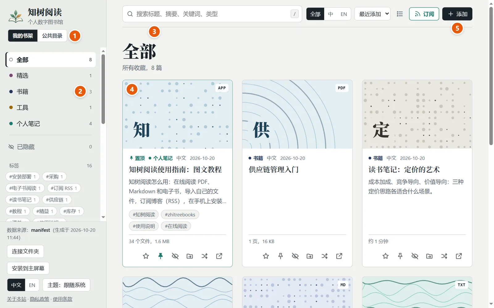

> **带图的在线教程**：网站首页置顶的第一张卡片就是《知树阅读使用指南》（源文件在 `library/notes/guide/`，一个自带“使用说明 / 安装部署”切换标签的页面；有中文和英文两个版本，英文版在 `library/notes/guide/en/`，把界面切到英文就会打开它）。本文是同一份内容的文字版，后面还有全部技术细节。

---

## 使用说明

给读者和使用者：怎么读、怎么存自己的文件、怎么在手机上用、怎么投稿。不用注册，不用登录。

### 1. 认识首页

1. **我的书架 / 公共目录**：两个空间，点一下切换。
2. **分类和标签**：点分类只看这一类，点标签按主题筛选；下面的“卡片目录”列出每类文章的标题，点一下跳到那张卡片。
3. **搜索**：标题、摘要、关键词一起搜，按 `/` 直接跳到搜索框。
4. **卡片**：封面、标题、摘要、阅读时间，点它开始阅读（右上角的小标记是文件类型，`APP` 是网页小工具）。
5. **添加**：把你自己的文件放进来（见第 4 节）。

搜索框右边还有语言筛选（全部 / 中 / EN）、排序（最近添加 / 最近阅读 / 标题）、列表 / 卡片视图、订阅；左下角切换界面语言和主题（跟随系统 / 浅色 / 深色）。

### 2. 读一篇

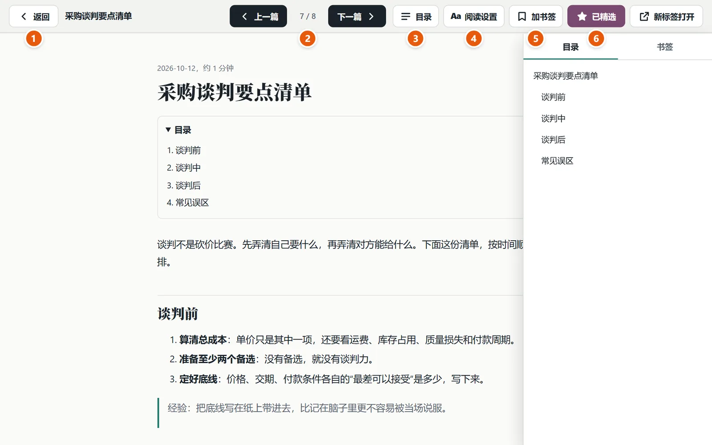

顶栏从左到右：**返回**、**上一篇 / 下一篇**、**目录**（取文章里的标题，右边还有“书签”页）、**阅读设置（Aa）**、**加书签**、**精选**、**新标签打开**。滚动时自动记住进度，首页的“继续阅读”列出读到一半的几篇。快捷键：`Esc` 关闭，`←` `→` 翻页。

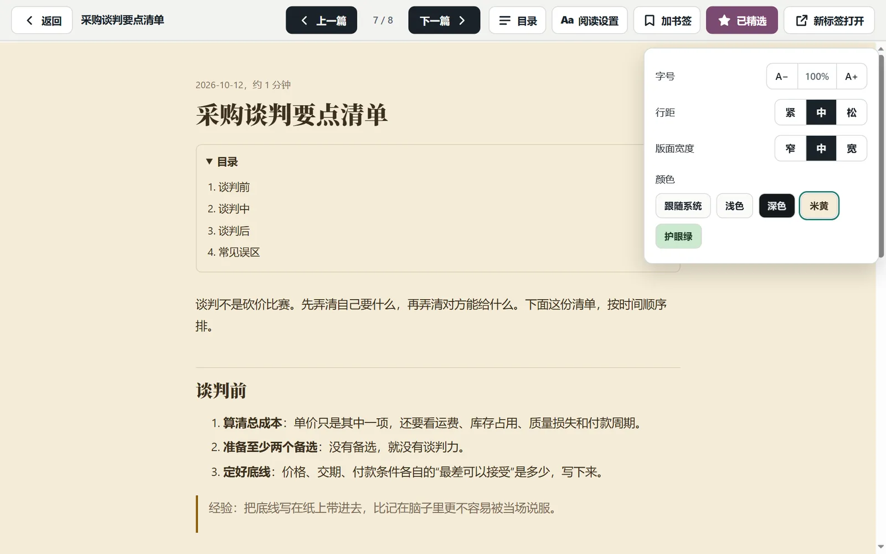

阅读颜色有“跟随系统 / 浅色 / 深色 / 米黄 / 护眼绿”；Markdown 和 TXT 还能调字号、行距、版面宽度。HTML 和 PDF 保持原样，只能换颜色（PDF 没有目录和书签）。

### 3. 卡片上的按钮

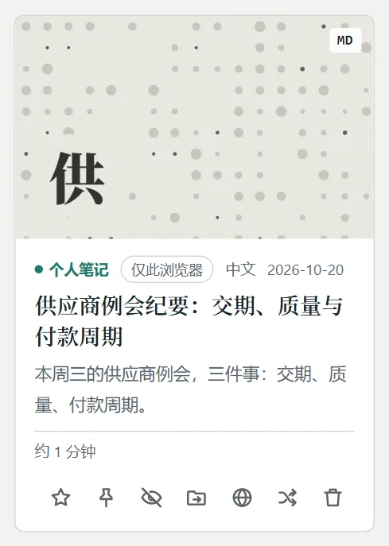

| 按钮 | 作用 |
| --- | --- |
| 星标 | 设为精选，收进“精选”分类 |
| 图钉 | **置顶**：排在最前面，带“置顶”标记；多篇置顶时最后置的排最前 |
| 眼睛 | 隐藏：从分类和搜索里拿掉，不删文件；左侧“已隐藏”里恢复 |
| 文件夹箭头 | 移到其他分类（你自己的文件还能换合集） |
| 地球 | 把这一项送去公共目录审核（站点开通了才有） |
| 交叉箭头 | 换一张封面 |
| 外链箭头 | 新标签打开（站点上的卡片） |
| 垃圾桶 | **删除**，只有你自己的文件才有，会先确认，删了找不回来 |

**站点自己的书访客删不了**：卡片上没有垃圾桶，网站也没有任何“删除”请求可调用；只有站长在自己电脑的 `library/` 里删，再重新部署。访客在线上点的星标、置顶、隐藏、移动分类，只保存在他自己的浏览器里，不影响别人。

### 4. 放进你自己的文件，用合集分组

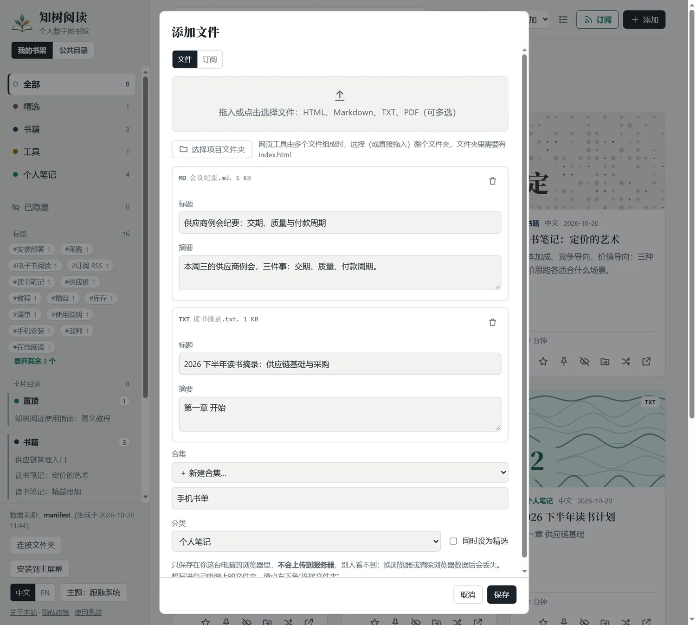

点“添加”（或把文件拖进页面）→ **一次可以选很多个** HTML / Markdown / TXT / PDF（单个不超过 30 MB）→ 选好合集和分类 → 保存。它们只存在**你这个浏览器**里，不会上传，别人看不到；换浏览器、换设备或清除网站数据就没有了，手机和电脑之间**不同步**。想长期放在自己电脑上，用左下角的“连接文件夹”（Chrome / Edge）。

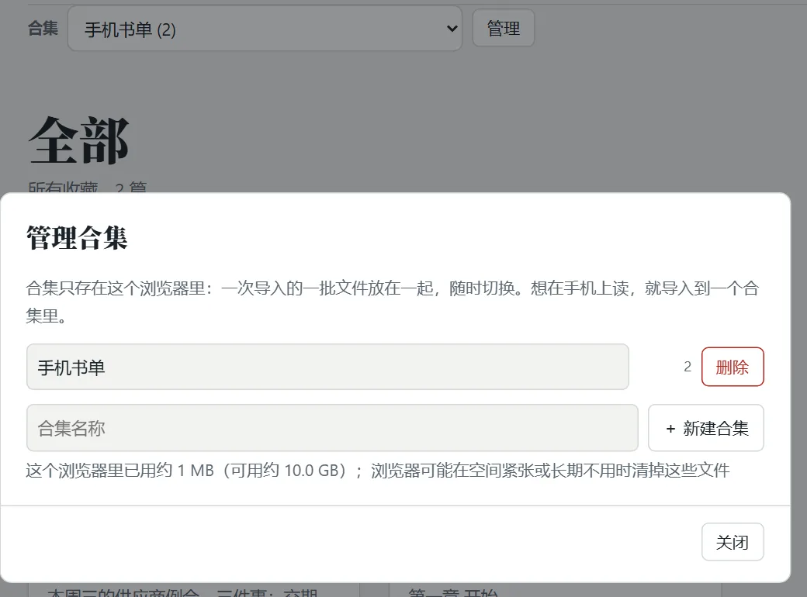

一次导入的一批文件可以放进一个**合集**。选中一个合集后，卡片、分类、标签、搜索、“继续阅读”都只显示这个合集。电脑上用页面上方的“合集”下拉框，手机上在左侧目录最上面。“管理”里可以新建、改名、删除（删除合集会连里面的文件一起删，会先问）。

#### 订阅别人的博客和文章源

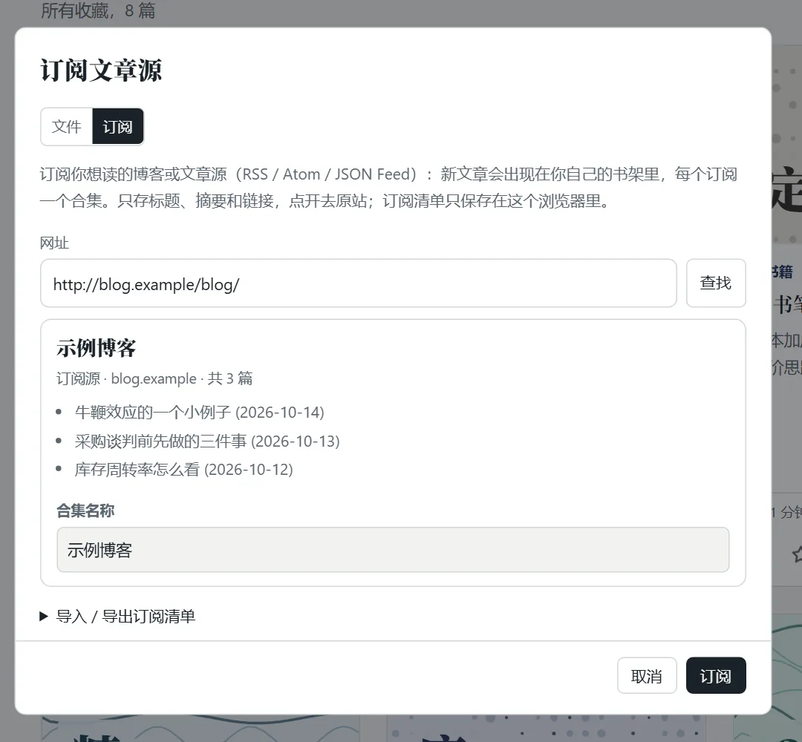

“添加”窗口的第二个标签 **订阅**：贴一个博客首页或订阅源（RSS / Atom / JSON Feed）→ “查找”（显示名字和最近几篇）→ 起个合集名 → 订阅。**每个订阅是一个合集**，新文章出现在里面，带“新”标记，合集旁边显示有几篇新的；点文章在阅读器里读。

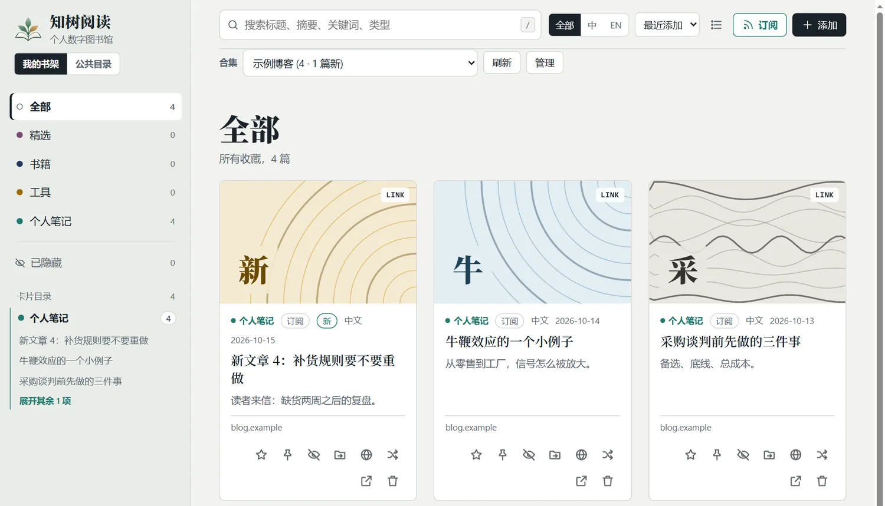

- **订阅源自带全文时，最近的 12 篇会带上正文**（每篇限 6 万字符，一次回答总共限约 150 万字符；只带摘要的源、不够 500 字的描述，不当作正文），页面保存最近 30 篇的正文，卡片上有“全文”标记，点开在阅读器里读（阅读设置里可以改字号、颜色，也可以“下载网页（HTML）”或“打印 / 存为 PDF”），顶栏和文末都有“阅读原文”。和收藏的链接一样可以搜索、加星、置顶、隐藏、删除（删掉的那一篇下次更新不会再出现）。每个订阅保留最近 60 篇，加了星或置顶的不清。正文都是更新服务重建成的一个很小的安全子集（只留文字、图片、链接和常见排版，不留脚本、样式、框架、表单），页面显示前再清理一遍，并放进一个不允许任何脚本、不发 referer 的文档里。
- **任何链接都在站内读**：订阅源只带摘要的、你收藏或粘贴的任意文章链接、公共目录里的文章，点开时由更新服务的 `read` 动作去读原文页面，提取正文后显示在阅读器里（慢的页面要十几秒，先显示“正在读取原文…”和一个“打开原文”按钮），正文存在你的浏览器里，下次秒开；订阅的最新 5 篇会在空闲时提前读好。**读不了的**（要登录或付费、人机验证、靠脚本显示正文、PDF、robots.txt 不允许、对方 4xx/5xx）说明原因并打开原文，卡片标“仅原站”（一周后重试）；网络问题不算结论，下次再试。读页面时不带 cookie、不登录、自报家门（`ZhiTreeBooks-Reader/1`），默认遵守对方的 robots.txt。
- **更新**：打开页面时自动更新（距上次超过 3 小时），或点“刷新”（页面上方、左侧合集列表、合集“管理”里都有）。**网页没法在后台定时更新，所以没有推送**；没有网络时看上次存下的。
- **试试这些**：公共目录里被站长标成“新读者可订阅”的订阅源（`registry/shelves.json` 里该条有 `"starter": true`，或用 `python aggregate.py approve 网址 --starter` 登记），会在“添加 → 订阅”窗口里列成一排，每条一个“订阅”按钮，点一下就订阅（直接按目录里记的订阅源地址，不再查找一遍）并立刻读第一批文章；可以连着点几个，点“完成”回到书架。最多 16 个，读者的界面语言排前面；没有这样的源或没开通目录时这一块不出现。
- **贴的是一篇文章**（没有订阅源）：只能存成一条链接，不会更新；读得了的话正文一起存下来。
- **换设备**：合集“管理”（或添加窗口的“导入 / 导出订阅清单”）里导出 OPML、或复制“清单链接”（网址放在 `#` 后面），到另一台设备导入或打开。**只同步订阅清单**，文章和已读状态各设备自己更新。OPML 也能和 Feedly 等阅读器互通。上限 30 个订阅。
- **隐私**：别人的网站不让网页直接读，所以由目录项目的“更新服务”`/api/feed` 代读：你订阅的网址、点开的文章网址会发给它，它读完把标题、摘要和正文还给浏览器，**自己什么都不保存**（见隐私政策）。没开通目录和提交服务的站点没有这个标签。

### 5. 在手机上用

- **装到主屏幕**：Android Chrome 点左侧栏底部的“安装到主屏幕”（或菜单里的“添加到主屏幕”）；iPhone Safari 点“分享 → 添加到主屏幕”。装好后全屏打开，打开过的页面和文件（最多 120 个）**没有网络也能读**。**iPhone 一定要装到主屏幕再用**，否则 Safari 约 7 天不用就会清掉你添加的文件和进度。
- **左侧目录**：点左上角的 `≡`，最上面是合集，然后是分类、标签、卡片目录。**把目录里的一条往左滑**：你自己的文件露出红色“删除”，站点上的书露出灰色“隐藏”（在“已隐藏”里则是“恢复”）。
- **分享到知树阅读（Android）**：装好后在文件管理器、微信、浏览器里点“分享”，选“知树阅读”，文件会打开“添加”窗口，网址会存成“收藏的链接”。iPhone 没有这个入口，用“添加”多选文件。
- **备份与恢复**：左下角的“备份与恢复”可以把这个浏览器里的东西导出成一个 .zip（完整备份：你添加的文件、合集、订阅、收藏的链接、阅读进度、书签、星标和设置），或一个很小的 .json（只有书单和设置，不含文件内容）；恢复时先显示备份里有什么、哪些已经在这里，点“合并”才导入，**只合并、不删除现有内容**，内容相同的文件不重复。备份由浏览器生成、保存在你自己的设备上，不经过服务器。站点自带的书和连接的本机文件夹里的文件不在备份里。
- **同步（可选）**：站点开通同步服务时，左下角有“同步”按钮。第一台设备点“开启同步，生成同步码”并保存好同步码，另一台设备输入同步码“连接”；之后改动几秒后自动同步（回到页面时也同步一次）。**同步书单、收藏的链接、订阅清单、合集、阅读进度、书签、星标和置顶；体积小的文本文件（Markdown / TXT / HTML，单个约 1 MB 以内）连内容同步，在别的设备上打开时才取回，最近 8 篇会提前取回；PDF 等大文件只同步书单**（卡片上标“仅书单”，要带过去用“备份与恢复”）；订阅里的文章不同步（各设备自己从订阅源读）。加密在浏览器里完成（AES-GCM，钥匙由同步码算出），同步服务读不了任何内容，同步码丢了无法找回；免费空间约 9 MB，半年不用清掉；两边同时改同一处时，进度取较新的、书签合并、其余以正在用的这台为准，一边删除一边改动的保留改动；断网、空间已满、同步空间过期（会用本机现有内容重建，不删任何东西）都有提示。用满 20 分钟（只算页面在前台且有操作的时间）后会问一次“如果以后有大文件同步，愿意付费吗”，回答只作为匿名计数发给同步服务。
- **排序**：最近添加 / 发布日期 / 最近阅读 / 标题（公共目录里只有“最近添加”和“标题”，它本来就按最新排）。没有“热度”排序：站点没有任何统计，不知道哪篇更热。
- **手机**：卡片视图两列，卡片上除星标外的按钮收在“…”里（列表视图仍是一列、按钮都在）；读文章时向左 / 向右滑 = 下一篇 / 上一篇（读的是页面里的文档；PDF 这类滑不动的文件，目录面板里留着上一篇 / 下一篇按钮），书架上向右滑打开左侧列表、向左滑收起。手势排除了：会横向滚动的代码块和表格、选中了文字、放大了页面、距屏幕边缘 20px 以内（系统返回手势）、多指；读者页面带 `touch-action: pan-y pinch-zoom` 和 `overscroll-behavior-x: none`，浏览器自己的“横滑返回”不会抢走手势。
- **这是什么**：第一次打开首页会弹出一个说明窗口（只一次），回答“这是什么、东西存在哪、公开还是私有、不是什么”；之后在左下角点“这是什么”再看。**有更新时**，下次打开会弹出一次“更新说明”。发布新版本时在 `index.html` 里同时改 `APP_VERSION` 和 `CHANGELOG`（日期大的在前，中英文各写几条）。

<p align="center">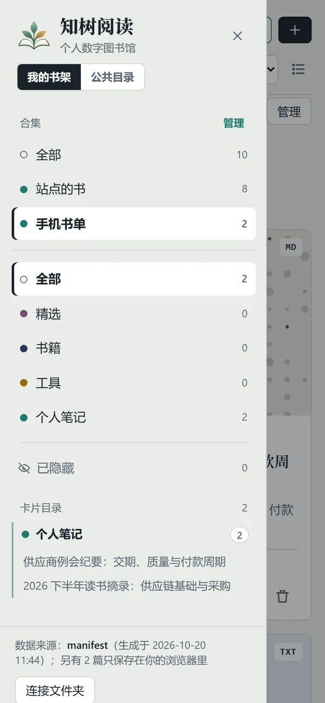 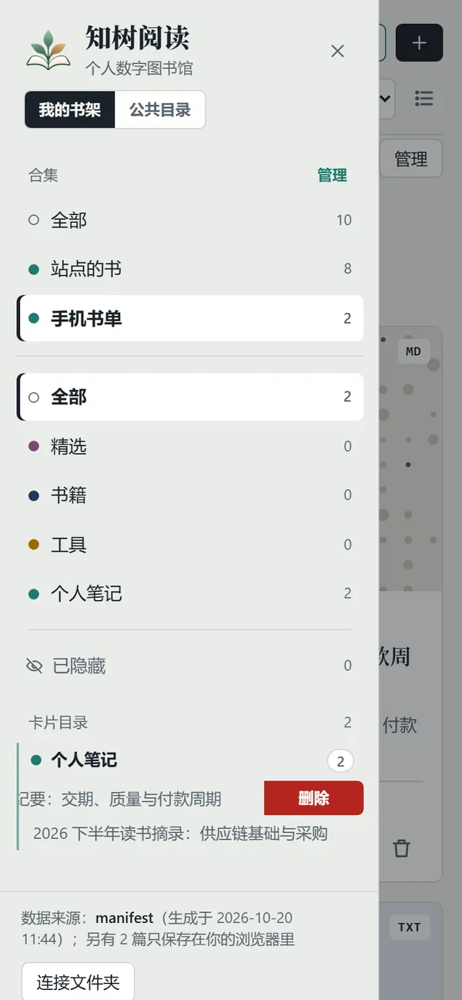 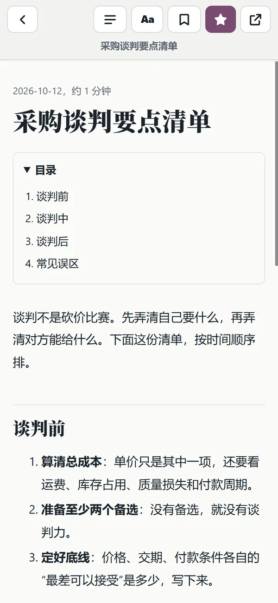</p>

### 6. 公共目录与投稿

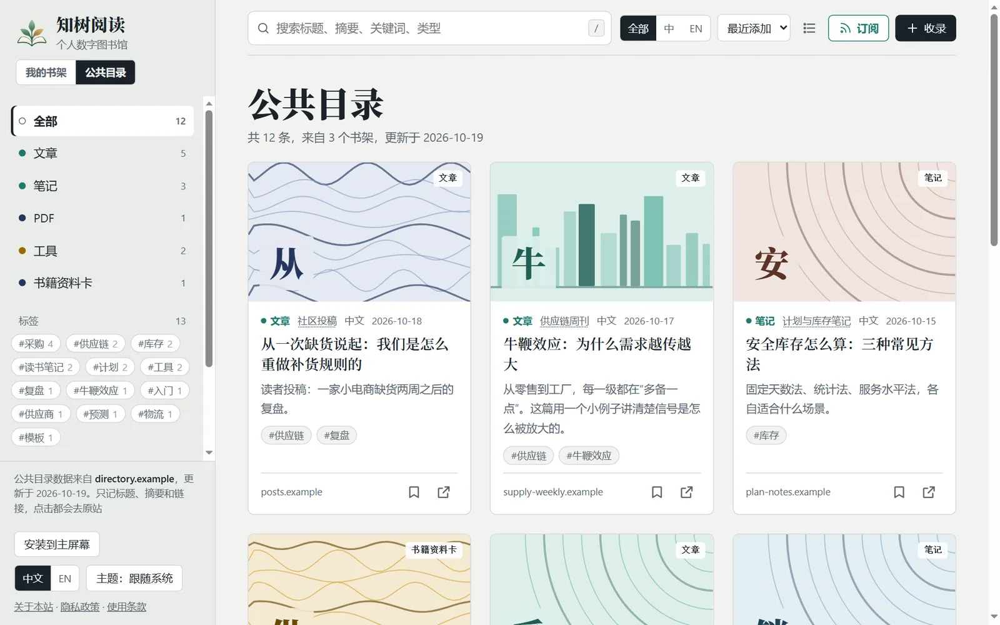

“公共目录”把很多人的博客、文章、GitHub 仓库、视频汇成一份目录，**只记标题、摘要、封面图地址和回原站的链接**，点击都去原站。可以按类型、标签、书架筛选和搜索；卡片上的书签把链接收藏进你自己的书架；顶栏“订阅”订阅整个目录、某个类型、标签或书架。

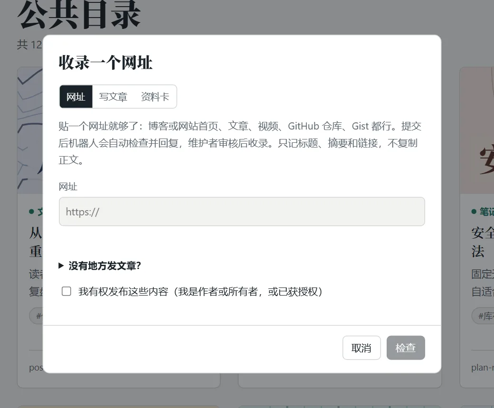

**投稿不需要账号，三种方式**：① 点“收录”贴一个网址 → “检查”（会告诉你它是什么、找到几篇，并先拦下目录里已有的）→ 勾选声明 → 提交；② 在“收录”里切到“写文章”，由目录托管成一个公开页面（不显示图片，可要求下架）；③ 点“我的书架”卡片上的地球图标（有网址的送网址，Markdown / TXT 送正文，书 / PDF / 工具只送一张资料卡）。提交后进站长的审核队列，通过后出现在目录里。别贴 `…/#read/…` 这种阅读器地址，那只有你自己的浏览器打得开。

### 7. 订阅本站（RSS）

点顶栏的“订阅”（订阅**这个网站**，用你自己的 RSS 阅读器读；订阅别人的文章见上面第 4 节）：有“在 Feedly / Inoreader 中订阅”的一键链接和复制按钮，可以只订阅全部、某个分类或某个标签。

下面几节是同一部分的详细说明（访客的本地使用、格式、阅读体验、手机安装的细节）。


### 详细说明：访问者的本地使用（部署的站点上，或不开 `serve.py` 时）


页面上显示的是三份内容**并排**，互不替换：服务器自己的列表、访问者自己连接的本机文件夹、访问者在浏览器里添加的文件。后两份卡片上会标出“本机文件夹”“仅此浏览器”，**只存在访问者自己的电脑上，不会上传到服务器，别人也看不到**。

- **连接文件夹**（Chrome / Edge，左下角）：选自己电脑上的一个文件夹（选 `library` 或包含 `books/ tools/ notes/` 的目录），里面的文件就和服务器的列表一起显示。连接后“添加”写进这个文件夹，星标 / 隐藏写进它的 `_meta.json`。“更换本机文件夹”“断开”在同一处。
- **添加文件（可以一次多选）**：没连接文件夹时，“添加”把文件存在这个浏览器里（上限 30 MB 一个）；换浏览器或清除浏览器数据会丢失。这些文件可以改分类，也可以直接点卡片上的垃圾桶删除（删除前会确认）。
- **合集（在手机上读，就导入到一个合集里）**：添加时可以选“放进哪个合集”：新建一个（第一次添加会自动建，默认叫“我的合集”，可以改名）、放进已有的，或不放进合集。添加完页面自动切到这个合集。页面上方出现“合集：全部 / 站点的书 / 你的各个合集 ▼”；**手机上点左上角的目录按钮，左侧列表最上面也有一份“合集”列表**（带数量，当前的高亮，旁边有“管理”），点一个就切换并收起列表。**选中一个以后，卡片、侧栏分类、标签、搜索、“继续阅读”都只显示这个合集**，这样手机上可以只留一个干净的书架。“管理”里可以新建、改名、删除合集（删除会连里面的文件一起删，要确认），并显示这个浏览器里已用的存储空间；卡片上的“移到其他分类”里还可以把某个文件放进别的合集。合集只存在这个浏览器里，不会上传，也不会同步到别的设备；导入的是**复制**，原文件改了要重新导入。
- **分享到知树阅读（Android）**：把站点装到主屏幕后，在文件管理器、微信、浏览器里点“分享”，选“知树阅读”：分享的 PDF / Markdown / TXT / HTML 文件会打开“添加”窗口，选好合集点保存；分享的**网页地址**直接存成“收藏的链接”（放进当前显示的合集）。装好之后要等浏览器更新应用信息（通常一天内，重装主屏幕图标会立刻生效）才会出现在分享列表里。iPhone 的 Safari 不支持这个，用“添加”多选文件（在“文件”App 里选“全选”就等于导入整个文件夹）。分享的文件在你点保存之前只放在这个浏览器的临时缓存里，不会发到任何服务器。
- 用 `serve.py` 时不显示“连接文件夹”：那时 `library/` 本来就是你自己的文件夹，“添加”直接写进去。
- 限制：本机文件夹和浏览器里的内容读不到工具（多文件网页）的 css / js，也不能添加项目文件夹，这需要 `serve.py`。双击打开 `index.html` 时，没连接文件夹就读不了 Markdown / TXT（浏览器限制）。

### 详细说明：支持的格式


| 格式 | 标题 | 摘要 | 阅读方式 |
| --- | --- | --- | --- |
| HTML | `<title>` | description 或导语段落 | 保留原网页的设计（只能换颜色；标题规范的页面有目录和书签） |
| Markdown | front matter 或第一个 `#` 标题 | front matter 或第一段 | 统一排版，字号 / 行距 / 宽度 / 颜色可调，有目录和书签；三个以上小标题时文章开头还有一份目录 |
| TXT | 第一行 | 后面的文字 | 统一排版，同上；以“第三章”“第12回”“Chapter 4”开头的短行（至少两处）当作章节标题，生成目录 |
| PDF | 文档属性里的标题，否则文件名 | 添加时手动填 | 浏览器自带的 PDF 阅读器（只能换颜色，没有目录和书签）；手机，或浏览器把 PDF 设成“下载”时，显示“打开 / 下载”按钮 |

单个文件上限 80 MB。Word（.docx）不支持，请另存为 PDF 或 Markdown。

HTML 里可选的 meta：`description`、`keywords`、`archive:category`、`archive:featured`、`archive:cover`、`archive:date`；Markdown 开头可写 front matter（`title`、`description`、`tags`、`featured`）。

### 详细说明：阅读体验


所有格式放进同一个阅读器，顶栏有同一套按钮（手机上更紧凑）：

- **阅读设置（Aa）**：颜色有“跟随系统 / 浅色 / 深色 / 米黄 / 护眼绿”，设置会记住。Markdown 和 TXT 是我们自己排版的，所以还能调**字号、行距、版面宽度**；HTML 和 PDF 按原样显示，只能换颜色（深色是整体反色，米黄 / 护眼绿是盖一层色调），字号请用浏览器自带的缩放。注意这是**换色调**，网页做不到真正的滤蓝光。
- **目录**：Markdown、TXT 和结构规范的 HTML 取它们的标题（h1–h4），点一下跳到那一节，并标出读到哪一节；没有标题的页面显示“没有可用的目录”。**PDF 由浏览器自己显示，没有目录和书签**（扫描版没有文字，也生成不了）。手机上点“目录”会从右边滑出，底部有上一篇 / 下一篇。
- **书签**：点“加书签”记下现在读到的位置（同一处再点会替换），在目录面板的“书签”页里点一下回到那里、点 × 删除。书签记的是“读到百分之几 + 最近的标题”，只存在这个浏览器里。书签（记位置）和“设为精选”（收藏整篇）是两回事。
- **进度与继续阅读**：滚动时自动记住进度，下次打开回到那里；首页的“继续阅读”列出读到一半的几篇。
- **分类**：“移动到其他分类”现在在三种情况下都能用：`serve.py` 里真正移动文件；浏览器里添加的文件改分类；**部署的站点和连接的本机文件夹**里，调整只记在这个浏览器里（站点）或这个文件夹的 `_meta.json` 里（文件夹），不会改动网站。
- 所有这些设置、书签、进度都只保存在访问者自己的浏览器里，**不会同步到别的设备**（想要跨设备，只有公共空间能同步，且只同步公开的内容）。

#### 装到手机主屏幕（PWA）

部署的站点可以“安装”：Android Chrome 左侧栏底部会出现“安装到主屏幕”（或用浏览器菜单里的“添加到主屏幕”）；iPhone 在 Safari 里点“分享 → 添加到主屏幕”（页面上的按钮会提示这个步骤）。装好以后全屏打开，像一个 App；打开过的页面和文件（最多 120 个，单个不超过 15 MB，PDF 的分段请求不缓存）会保存在浏览器里，**没有网络也能再读**，首页和阅读器本身也能离线打开。

- **iPhone 一定要装到主屏幕再用**：不装的话，Safari 会在约 7 天不用后清掉这个网站的数据（阅读进度、书签、你添加的文件都会丢），装到主屏幕的不受这个限制。
- 页面第一次访问时会请求“持久存储”，浏览器同意的话数据不会被自动清理。
- `serve.py` 本地预览不注册离线缓存，永远显示文件夹当前的样子。离线缓存的代码在 `sw.js`，图标在 `icons/`，应用信息在 `manifest.webmanifest`；改了 `sw.js` 里的缓存规则后把里面的 `VERSION` 加一，旧的缓存就会清掉。
- 不做小程序和原生 App：手机上浏览器读不了“本机文件夹”（只能一次选几个文件存进浏览器），这是网页的限制；所以手机上用“添加（多选）”和“分享到知树阅读”，把文件放进合集（见上面“访问者的本地使用”）。

### 详细说明：阅读与快捷键


点卡片在站内阅读，顶栏有上一篇 / 下一篇、“设为精选”、“新标签打开”；会记住阅读进度，首页显示“继续阅读”。`/` 聚焦搜索，`Esc` 关闭阅读，阅读时 `←` `→` 切换。卡片上的“隐藏”不删除文件，在左侧最下方的“已隐藏”里可以恢复；要删就点卡片上的垃圾桶（部署的网站上的书访客删不了，只有你在自己电脑上的 `library/` 里能删）。

侧栏的“卡片目录”按分类分块：彩色的分类标题可以点，直接进入该分类；每类默认只列前 3 篇，其余折叠，点“展开其余 N 项”查看、点“收起”折回。关于本站 / 隐私政策 / 使用条款在侧栏最底部。

---

## 安装部署

给站长：怎么在自己电脑上用、怎么部署上线、怎么开通公共目录和审核页。

### 你需要什么

| 要做的事 | 需要 | 必须吗 |
| --- | --- | --- |
| 在自己电脑上用 | Python 3（不用装任何依赖） | 必须 |
| 发布到网上 | Node.js、Vercel 账号（免费的就行） | 想让别人访问就需要 |
| 自己的网址 | 一个域名，在 Vercel 里绑定 | 可选 |
| 公共目录和投稿 | GitHub 账号 | 可选 |

### 速览：三步上线

1. `python serve.py`（Mac / Linux 用 `python3 serve.py`），往 `library/` 里放内容，本地看效果；
2. `npm i -g vercel` → `vercel login` → 在项目文件夹里 `vercel`（第一次创建项目）→ `vercel --prod`；构建命令里的网址（`vercel.json` 的 `--site-url`）换成你自己的；
3. 可选：提交 `sitemap.xml` 给搜索引擎；开通公共目录和审核页（见下）。

想让这篇使用指南排在第一位：在文档开头写 `pinned: true`（Markdown front matter）或 `<meta name="archive:pinned" content="true">`（HTML），重新部署即可；在线上点图钉只对点的人自己有效。

### 审核页：输入密码就能管理

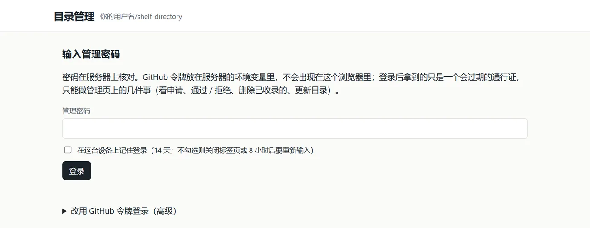

所有申请（GitHub 表单、网页上提交的网址、书架里的文章）都进同一个审核页：公共目录站点的 `/admin/`。在目录项目（`shelf-directory`）的 Vercel 环境变量里加 `ADMIN_PASSWORD`（**至少 12 个字符**）和 `ADMIN_GITHUB_TOKEN`（只选这个仓库：Issues 读写、Actions 读写、Contents 只读，不要和提交用的 `SUBMIT_GITHUB_TOKEN` 共用），重新部署即可。GitHub 令牌只放在服务器里，浏览器拿到的是会过期的通行证；通过 / 拒绝只改仓库里的数据，**不需要重新部署任何站点**。没配密码时页面会说明缺什么，并退回“用 GitHub 令牌登录”。

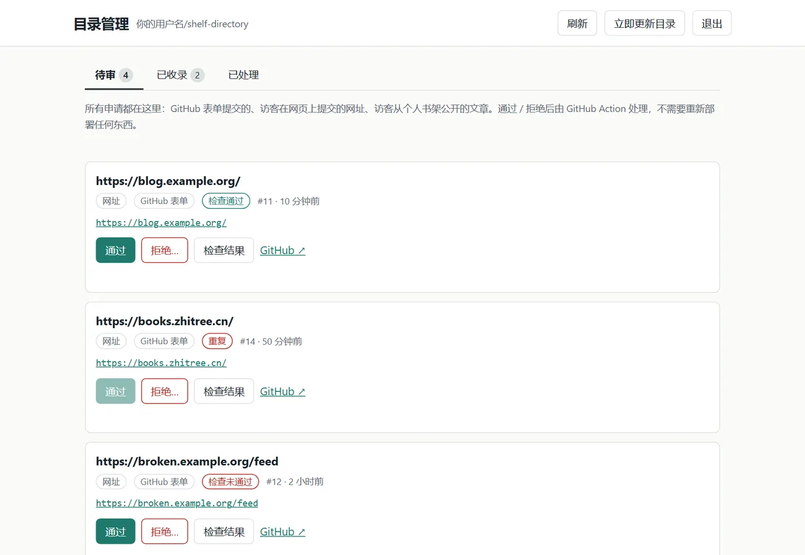


### 把指南发到知乎、小红书（`export_guide.py`）

同一份内容不用重写：`library/notes/guide/index.html` 是唯一的来源，改了文字再运行一次：

```bash
python export_guide.py            # 生成到项目旁边的 ../my-archive-export/（不会放进项目，否则会被部署）
python export_guide.py --no-cards # 不生成小红书卡片
```

需要 `lxml`、`Pillow`；要 Word 文件还要 `pip install python-docx`；小红书卡片用本机的 Edge 或 Chrome 渲染。生成的东西：

| 文件 | 怎么用 |
| --- | --- |
| `使用说明.docx` / `安装部署.docx` | **知乎**：写文章 → “导入文档” → 选这个文件，标题、列表、表格和图片都会带进来，检查一遍再发布 |
| `使用说明.md` / `安装部署.md` + `images/` | 任何 Markdown 编辑器（知乎的导入也认 `.md`，图片要从 `images/` 手动上传） |
| `xiaohongshu/01…08-*.png` + `文案.txt` | **小红书**：发图文笔记，按序号上传 8 张 3:4 卡片，正文粘贴 `文案.txt`（≤ 1000 字，含话题标签） |

图片全部是示例数据的截图（不含真实内容）。各平台的导入功能和发帖规则会变，上传后请先预览；小红书正文里没有放链接（站外链接容易被限流），写的是“搜站名”。

### 本地运行与管理（serve.py）


```bash
python serve.py        # Mac / Linux 用 python3 serve.py
```

浏览器会自动打开 http://127.0.0.1:8000 。就这一条命令：

- **实时扫描 `library/`**：往 `library/books|tools|notes|featured/` 里放文件，刷新页面就出现。
- **添加**：点右上角“添加”，或把文件 / 文件夹拖进页面，直接写入 `library/`。
- **移动分类**：卡片上的文件夹图标，选一个分类（书籍、工具、个人笔记……），文件（工具则是整个文件夹）会真的移到对应的 `library/<分类>/` 里，标题、星标、阅读进度跟着走。重名时自动加 `-2`。
- **删除**：卡片右下角的垃圾桶（点了会先问一次），文件（工具则是整个文件夹）会真的删掉，**无法恢复**；该卡片的阅读进度、书签也一并清掉。不想真删就用旁边的“隐藏”，在左侧“已隐藏”里可以恢复。
- **谁能删什么**：
  - 用 `serve.py` 在自己电脑上打开时，删的是你的 `library/`（只有这台电脑能访问）；要让网站上也消失，删完再 `vercel --prod` 部署一次。
  - 你在这个浏览器里添加的文件、收藏的链接：只存在你的浏览器里，随便删。
  - 你“连接”的本机文件夹里的文件：直接从那个文件夹里删掉（同时清掉它在 `_meta.json` 里的记录）。
  - **部署出来的网站上的书，访客不能删**，卡片上没有垃圾桶，网站也没有任何“删除”请求可调用；访客只能“隐藏”（只在他自己的浏览器里）。除了你本人在自己电脑的 `library/` 里删，没有别的办法。
- **手机上左滑删除**：打开左侧目录列表，把某一条往左滑，下面露出红色“删除”，点它（还会确认一次）就删掉，规则和上面一样；网站上的书（你删不了的）左滑露出的是灰色“隐藏”，在“已隐藏”里则是“恢复”。竖着滑仍然是滚动列表，滑过之后点一下别处会收回去。鼠标不触发，电脑上用卡片上的垃圾桶。
- 移动同理：`serve.py` 的 `library/` 里是真的挪动文件；部署的站点上访客的“移动分类”只保存在他自己的浏览器里。
- **星标、隐藏、改标题** 保存在 `library/_meta.json`。
- **置顶**：卡片上的图钉按钮（星标旁边）。置顶的卡片不管怎么排序、在哪个分类里都排在最前面，带“置顶”标记，左侧目录列表最上面也多出一个“置顶”分组；多篇置顶时，**最后置的排最前**（想让“使用说明”排第一，最后一个置顶它）。**让所有访客都看到的置顶**有两种做法，都要**重新部署**才会上线：① 在你电脑上用 `serve.py` 打开页面点图钉（写进 `library/_meta.json` 的 `"pinned": 置顶时的时间戳`；`serve.py` 要用新版本，旧的会提示“还是旧版本，没有保存置顶”，关掉重开即可）；② 在文档自己开头写：Markdown 的 front matter 里加 `pinned: true`，HTML 里加 `<meta name="archive:pinned" content="true">`（写数字也行，越大越靠前；页面里点的置顶排在它前面，页面里取消置顶则压过它）。**在已经部署的网站上点图钉只是访客自己的置顶**，保存在他自己的浏览器里（和星标、隐藏一样），别人看不到，站长也一样——线上没有后台，改不了服务器上的东西。你在浏览器里添加的文件、连接的文件夹里的文件同样可以置顶，连接的文件夹记在它的 `_meta.json` 里。
- **同一篇的另一种语言（英文版）**：一篇内容如果有中英文两个页面，各放一个 HTML 文件（英文页放在中文页同一个文件夹里最省事，比如一个 `index.html` + `en/index.html`；中英文页都是单独的文件时，英文那份也会多出一张卡片，不想要就隐藏它——但隐藏的不会部署，英文版也就没有了，所以更推荐放进文件夹），再在中文页里写上英文版的信息：HTML 用 `<meta name="archive:title_en" content="…">`、`archive:description_en`、`archive:keywords_en`、`archive:alt_en`（英文页相对于这一页的路径，必须是 `library/` 里的 HTML 文件，路径不存在、跑到 `library/` 外面、不是 HTML 的会被忽略）；Markdown 的 front matter 写 `title_en:`、`description_en:`（或 `summary_en:`）、`tags_en:`、`alt_en:`；也可以写进 `library/_meta.json`。页面界面是英文时，这张卡片显示英文标题、摘要、标签，点开的是英文页；界面是中文时一切照旧。部署时（`--seo`，要有站点地址）两个页面会互相补上 `hreflang`（`zh-CN`、`en`，`x-default` 指向英文页），英文页有自己的 canonical / Open Graph / `inLanguage`，两个地址都进 sitemap（带 `xhtml:link` 互指）和 `urls.txt`。**不会按浏览器语言自动跳转**（搜索引擎的爬虫语言常常是英文，自动跳转会让它看不到中文页）：页面只提供一个可关闭的提示条和一个“English / 中文”切换链接，由读者自己点。英文页上的站点名可以在 `site.json` 里用 `"name_en"` 指定（不写就和中文一样）。这份使用指南就是这样做的。
- `manifest.json` / `manifest.js` **自动保持最新**（启动时、每次刷新页面、`library/` 里有任何变化时），不需要手动运行 `build_index.py`。
- 只需要 Python 3，不用装依赖。服务只接受发往本机的请求；它能写文件，不要暴露到公网。
- 改了 `serve.py` 之后要重启它，否则运行中的还是旧代码。

### 项目结构


```
my-archive/
├── index.html        网页
├── serve.py          本地服务（默认用法）
├── build_index.py    扫描 library/ 生成清单；serve.py 内部也用它，单独运行只在不开 serve.py 时才需要
├── manifest.json     卡片清单（自动生成）
├── manifest.js       同上，双击打开 index.html 时读取
├── seo.py            给搜索引擎准备的内容（构建 dist/ 时用，见“搜索引擎”一节）
├── indexnow.py       部署后把新的、改过的地址告诉 Bing 等（IndexNow），只在你运行时才联网
├── about.html        关于本站 / 所有权与版权声明
├── privacy.html      隐私政策
├── terms.html        使用条款与免责声明（以上三个是普通 HTML，直接改文字即可）
├── site.json         署名、联系方式、许可说明、公共目录地址（都可选，不会发布；见“关于、隐私、条款页”）
├── vercel.json       Vercel 部署时自动构建 dist/，部署的就是它；还有 /library/… 的 301 跳转
├── dist/             构建出来的、要部署的站点（自动生成，已加入 .gitignore，不要手改）
├── vendor/           Markdown 渲染（marked）与安全过滤（DOMPurify），离线可用
└── library/
    ├── books/  tools/  notes/  featured/    一级文件夹就是分类，新建别的文件夹会成为新分类
    └── _meta.json
```

### 工具 = 文件夹


一个网页工具由多个文件组成（`index.html` + css + js + 图片）时，放进 `library/tools/<工具名>/`：

- **文件夹里有 `index.html`，整个文件夹就是一张卡片**（右上角有 **APP** 标记），里面的 css / js / 图片不会各自成卡。
- 添加：点“添加 → 选择项目文件夹”，或把文件夹拖进页面。`.git`、`node_modules`、以 `.` 开头的文件会自动跳过。
- 工具里的资源请用相对路径（`styles.css`、`js/game.js`），不要用 `/` 开头的绝对路径。
- 直接放在分类里的 `library/tools/index.html` 仍是普通的单文件卡片；没有 `index.html` 的文件夹只是普通文件夹，里面的文件各自成卡。

### 本地预览用 `serve.py`，不要用 `vercel dev`


`vercel dev` **启动时就记住了当时有哪些文件**：之后在 `serve.py` 里新增、移动的文件，它读到的清单里有、但文件本身会 404（已存在的文件被修改倒是能看到）。所以：

- 日常本地预览、管理都用 `python serve.py`，它是实时的。
- 非要看静态站点的效果，先停掉再重新运行 `vercel dev`。
- 在静态页面（`vercel dev`、线上）上点过“星标 / 隐藏”会记在那个浏览器里，并覆盖清单里的值；想清掉就清除该站点的浏览器数据。

### 部署到 Vercel


Vercel 是静态 / 无服务器平台，**不能运行 `serve.py`**（没有常驻进程，磁盘只读，也不能写文件）。部署时它会按 `vercel.json` 先运行 `build_index.py --seo`，把站点构建到 `dist/`，**部署的是 `dist/`，不是你的原文件夹**。所以：

```bash
vercel --prod        # 或者 git push（已接 Git 时）
```

- 部署出来的站点上，服务器的列表**始终照常显示**，对所有访问者只读：不能往服务器里添加、移动、删除，访问者的星标 / 隐藏只保存在他自己的浏览器里。访问者自己的本地使用见下一节。
- **隐藏的内容不会被部署**：`dist/` 里没有隐藏的文件，清单里也没有，`library/_meta.json` 同样不发布。想让某篇上线，就取消隐藏。
- 新文件必须重新部署才会出现（静态站点没有后台）。
- 看不到新内容时，打开 `https://你的域名/manifest.json` 看 `generated` 和 `items`：不在清单里 = 部署的不是最新文件。
- `.gitignore` 里不要忽略 `vercel.json`，也别写 `*.py`（构建需要 `build_index.py`、`seo.py`）。
- 网址写在 `vercel.json` 的构建命令里（`--site-url https://books.zhitree.cn`）；换域名就改这里。

### 搜索引擎（Google、Bing）


构建 `dist/` 时（`build_index.py --seo`）自动做这些，**你的原文件一个字节都不会改**：

- **每个 HTML 页面补上缺的标签**：描述（取自摘要）、canonical、Open Graph、Twitter 卡片、`Article` 结构化数据、`<html lang>`。页面里已经有的标签不会被覆盖或重复。构建日志会列出缺 `<meta name="viewport">`（手机端不友好会影响排名）的页面。
- **Markdown / TXT 文章生成带全文的静态页**：`articles/<分类>/<名称>.html`，有标题、描述、canonical、`Article` 结构化数据，正文和站内阅读器渲染出来的文字一致；文章里的图片和站内链接会跟着新地址走。卡片和“新标签打开”部署后都指向这个页面。
- **`sitemap.xml` 和 `robots.txt`**：sitemap 里放首页、所有 HTML / PDF 的地址、Markdown / TXT 的全文页、关于/隐私/条款三页，每条带日期。隐藏的、标了 `noindex` 的都不放。**每次部署都按当时的内容重新生成，新加的文章和页面自动进去**；文件名里的中文按规范写成百分号编码（`%E4%BE%9B…`，浏览器和 Google 都认），页面里的 canonical / og:url 写法与它一致。构建的最后会自检一遍（`SEO: sitemap check passed`）：每个地址都是本站的、编码合规、不重复、不超长，并且在要部署的文件夹里真的存在；有问题会在构建日志里逐条列出。根目录里你自己写的 `robots.txt` / `sitemap.xml`（不含“generated by build_index.py”那一行）不会被覆盖，原样发布。
- **短而规范的、只含 ASCII 的地址**：线上没有 `library/` 前缀，名字里的空格、括号、标点、`_` 都换成 `-`，字母转小写，最长 60 个字符：`library/books/My Book (2nd).html` → `/books/my-book-2nd.html`；工具是它的文件夹地址 `/tools/my-tool/`；重名自动加 `-2`。**名字里有中文（或别的非 ASCII 字符）的，地址变成“编号链接”**：保留名字里的英文数字，再加一个 6 位的固定编号，纯中文名就是 `n-` 加编号：`books/重资产 读书笔记.html` → `/books/n-909083.html`，`AI_劳动力报告.pdf` → `/notes/ai-760c41.pdf`。编号由文件在 `library/` 里的路径算出，每次构建都一样，只要文件不改名，地址就不变。**旧的中文地址不会失效**：构建时在旧地址留一个小页面，自动跳到新地址，并用 canonical 告诉搜索引擎新地址才是正式的（PDF 没法这样做，构建日志会提醒，需要的话在 `vercel.json` 里加跳转）。不想要编号链接、想保留中文地址：在 `site.json` 里写 `"ascii_urls": false`。想自己定名字：在 HTML 里写 `<meta name="archive:slug" content="my-name">`，Markdown 的 front matter 里写 `slug: my-name`，或在 `library/_meta.json` 里给它加 `"slug": "my-name"`（你自己写的名字原样使用）。旧的 `/library/…` 地址会 301 跳转到新地址。注意：只有线上地址变了，本机文件、`serve.py` 里的 id 和你的阅读进度都不变。**没有加密链接**：地址本来就是公开的，加密不会让它更安全，只会让它更难读；想让某篇不公开，用“隐藏”（隐藏的不会部署）。
- **一份能找到全部内容的清单**：构建会生成 `all.html`（把所有页面按分类列在一页上，每一篇都是一个普通链接，每个文章页和首页底部都链到它）和 `urls.txt`（所有地址，一行一个）。`all.html` 也在 sitemap 里。搜索引擎从任何一页都能顺着链接找到全部。
- **完全相同的文件只推一份**：`library/` 里内容一模一样的文件（比如同一本书在 `books/` 和 `notes/` 各放了一份），都会发布，但只有排在前面的那份进 sitemap 和清单，其余的 canonical 指向它，避免被当成重复内容；构建日志会告诉你有几份。想彻底去掉就隐藏或删掉多余的。
- **关键词与书籍标签（每个发布出去的页面自动加）**：`<meta name="keywords">`（页面自己写了就保持原样）、`article:section`、`article:tag`，和结构化数据里的 `keywords`、`articleSection`。词是按这个顺序凑的：页面自己的关键词 → 所在分类的常用词（书籍：书籍、电子书、读书笔记、在线阅读；笔记、工具、精选各有一组，英文页用英文词）→ `site.json` 里给全站加的 `"keywords"` / `"keywords_en"` → 站名；最多 12 个。**说明一页是讲某一本书的**：在 front matter 里写 `kind: book`（可再加 `author: 作者`、`isbn: 书号`），HTML 里写 `<meta name="archive:kind" content="book">`（`archive:author`、`archive:isbn`），发布时这一页的结构化数据就是 `Book`（作者、书号），并带上 `og:type=book`、`book:isbn`、`book:tag`。**不会自动把 `books/` 里的页面都标成 `Book`**：那里多半是读书笔记，说它是书就不准确了。要诚实：Google 和 Bing 基本不读 `<meta name="keywords">`，真正有用的是标题、描述、正文里的词和结构化数据，这几处都已经带上这些词。
- **英文介绍页 `en/index.html`**：项目根目录里一个手写的英文页（和 `about.html` 一样原样发布），发布后地址是 `/en/`。它和首页互为 `hreflang`（`zh-CN`、`en`，`x-default` 指向英文页），有自己的 canonical，两个地址都进 sitemap。页面里的“Open ZhiTree Books”链到 `/?lang=en`：带 `?lang=en` 或 `?lang=zh` 打开首页，界面就用这种语言（并记住，地址栏里的参数会去掉）。首页没有 JavaScript 时的文字里也有它的链接。首页还会带上 `og:image`（`icons/icon-512.png`），别人分享链接时有预览图。
- **有英文版的页面**：互相补上 `hreflang`，英文页有自己的 canonical，两个地址一起进 sitemap；写法见上文“同一篇的另一种语言（英文版）”。构建日志会写“SEO: N page(s) have an English version”。
- **标题和名称**：首页 `<title>` 是 `知树阅读｜个人数字图书馆：在线阅读书籍、PDF 与读书笔记`（`index.html` 里改；**只能有一个** `<title>` 和一个 `description`，写两个搜索引擎只会取第一个）；文章页标题是 `文章名 · 知树阅读`（取标题里 `｜`、`|`、` - ` 前面的短名，也可以在 `site.json` 里用 `"name"` 指定；英文页用 `"name_en"`，现在是 `ZhiTree Books`）；订阅源标题用完整的。`site.json` 里的 `"alternate_names": ["zhitreebooks"]` 会写进首页结构化数据的 `alternateName`，让人们常打的另一种写法也能对上你的站名。
- **首页**：canonical、结构化数据，以及一份给不运行 JavaScript 的爬虫看的文章列表（正文是 JS 画出来的，爬虫不一定看得到）。
- 你放在项目根目录的验证文件（`google….html`、`BingSiteAuth.xml`）和图标会原样带到线上。首页里已有的 Google 验证标签保留；Bing 验证可以在 Vercel 环境变量里设 `BING_SITE_VERIFICATION`，Google 同理 `GOOGLE_SITE_VERIFICATION`。

**关于链接：** `https://域名/#read/…` 是站内阅读器的链接，`#` 后面的部分搜索引擎会忽略，所以它们都等于首页，永远不会被单独收录。**分享、外链、提交收录时用真实地址**：HTML / PDF 用 `/books/…` 这样的文件地址，工具用 `/tools/名称/`，Markdown / TXT 用 `/articles/…` 页面；站内卡片上的链接已经是这些地址。

#### 订阅（RSS / Atom）

构建 `dist/` 时（需要网址）自动生成两份订阅源，内容相同、格式不同：`/feed.xml`（Atom）和 `/feed.json`（JSON Feed 1.1）。

- **读者怎么订阅**：点顶栏绿色的“订阅”按钮，里面有“在 Feedly / Inoreader 中订阅”的一键链接和复制按钮；或者把本站网址直接粘贴进阅读器，页面里的自动发现链接会让它们自己找到订阅源。本地 `serve.py` 里没有这个入口（没有订阅源）。
- **可以只订阅一部分**：订阅窗口里的“订阅哪一部分”可选**全部、某个分类、某个标签**，打开时会默认选中你正在看的分类或标签。每个分类一份订阅源 `/feed/<分类>.xml`（`.json`），每个标签一份 `/feed/tag/<标签>.xml`（最多 100 个标签），清单在 `/feed/index.json`。标签来自文章的关键词：Markdown 的 front matter `tags: [供应链, 库存]`，HTML 的 `<meta name="keywords" content="供应链, 库存">`，或 `library/_meta.json` 里的 `keywords`。卡片上和侧栏里会出现这些标签，点一下就按它筛选。
- **内容**：最近 50 条，每条是标题、摘要、链接、日期、标签。**只放摘要不放全文**，读者点进来读（订阅源对内容类型没有限制，只是这里不放正文、封面和视频）。隐藏的和 `noindex` 的不会出现。Markdown / TXT 的链接是它们的全文页，工具的链接是它的文件夹地址。
- 条目的 id 就是它的公开网址：把一篇文章移动或改名，订阅者会把它当成新条目。
- 订阅源里带一小段 `_shelf` 扩展字段（书架规范版本、可选的许可说明、每条的类型和分类），让公共目录能更准确地收录你的站点，见 `shelf-directory/SHELF-SPEC.md`。
- 项目根目录里你自己放的 `feed.xml` / `feed.json` 不会被覆盖，原样发布，这时不再生成订阅源和自动发现链接。

#### 关于、隐私、条款页

`about.html`、`privacy.html`、`terms.html` 是项目根目录里的普通 HTML，**直接改文字**。构建时会自动补上 SEO 标签、放进 sitemap，首页侧栏底部和文章页底部有它们的链接。联系方式和署名放在 `site.json`（不会发布）：

```json
{ "owner": "你的名字或昵称", "contact": "you@example.com", "license": "CC BY-NC 4.0", "directory": "https://用户名.github.io/shelf-directory/" }
```

`license`（可选）是你对站点内容的许可说明，会写进订阅源，公共目录里会显示；`directory`（可选）是公共目录的地址，填了之后页面左侧出现“我的书架 | 公共目录”（见“公共目录”一节）。填了 `owner` 和 `contact` 之后三个页面里的“站长本人”“暂未公开”会被替换（邮箱会变成可点击的 mailto 链接），页面的 `<meta name="author">` 和结构化数据里也会带上署名。没填就显示默认文字。隐私政策写的是本站**目前的实际情况**（不设 Cookie、没有统计和广告、托管在 Vercel、字体来自 Google Fonts、本机数据只留在访客浏览器里）；以后加了统计、评论、广告等，请先改隐私政策再上线。这些法律文字是按常见个人站点写的，请你通读一遍，不合适的地方自己改。

**不想被收录**但又要公开的页面：在 HTML 里写 `<meta name="robots" content="noindex">`，或在 `library/_meta.json` 里给它加 `"noindex": true`。它不会进 sitemap，并写进 `robots.txt` 的 Disallow。完全不想公开就“隐藏”。

**部署后要你做的：**
1. Google Search Console：添加 `https://books.zhitree.cn/` → 验证（首页已有验证标签）→ “站点地图”里提交 `sitemap.xml`。
2. **提交后显示“无法获取”，多半不是你的问题**：新提交的站点地图经常先显示这个状态，过几小时到两天才变成“成功”。先确认这个地址在浏览器里能打开、内容是 XML；robots.txt 里已经有 `Sitemap:` 一行，Google 也会自己发现。可以等一等，或在“检查网址”里输入 `https://books.zhitree.cn/sitemap.xml` 做“实时测试”，再对首页点“请求编入索引”。
3. Bing Webmaster Tools：可以直接“从 Google Search Console 导入”（这同时完成了所有权验证），或添加站点后提交同一个 `sitemap.xml`。
4. 之后每次部署都会重新生成，不需要再提交。

**想一次性把所有地址都告诉搜索引擎：**
- **Google：没有任何官方的“自动请求编入索引”。** “网址检查 → 请求编入索引”只能在网页上手动点，也没有对应的接口（URL Inspection API 只能查状态，不能请求；Indexing API 官方只给招聘信息和直播页面用，拿来提交普通页面不被允许）。所以不用也不需要一个一个去请求：把 `sitemap.xml` 提交一次（可以再把 `urls.txt`、`feed.xml` 也作为站点地图提交），之后每次部署都会重新生成，Google 按自己的节奏来读；每条地址的 `<lastmod>` 是文件的日期，改过的页面日期会变，这是它判断“哪些变了”的依据。`all.html` 把全部页面链在一页上，首页和每个文章页底部都链到它，爬虫顺着链接也能走全。真想加快，只对**首页和 `all.html`** 请求一次编入索引，让它先读到这两个入口，其余会被顺着发现。
- **Bing、Yandex 等（IndexNow）可以自动：** `python indexnow.py --init` 生成密钥并写进 `site.json`（`indexnow_key`）→ 部署一次（构建会把密钥文件 `<密钥>.txt` 放到站点根目录，这个密钥本来就是公开的）→ 之后每次部署完运行 `python indexnow.py`，或者一条命令 `vercel --prod && python indexnow.py`。它读**线上**的 `sitemap.xml`，和上次发过的对比，**只把新的和改过的地址**发给 IndexNow，发过的记在 `.indexnow-state.json` 里（不发布、不提交）；`--dry-run` 只看不发，`--all` 全部重发。这个脚本只在你运行时才会联网，并且先检查密钥文件已经在线。

本地想看构建结果：`python build_index.py --seo --site-url https://books.zhitree.cn`，然后看 `dist/`（它只是构建产物，`serve.py` 用的仍是原文件夹）。

### 公共目录（聚合别人的博客、文章、GitHub 仓库）


公共目录把很多人的网站聚合成一份目录：**不收文章、不设账号**，只记标题、摘要、封面图地址和回到原站的链接，点击都去原站。它的数据和程序在**单独的仓库** `shelf-directory`（和本项目同级的文件夹，设置步骤见它的 README），由 GitHub 每天自动更新；本站只负责显示。

- **打开**：在 `site.json` 里写上 `"directory": "<目录地址>"`。页面左侧会出现“我的书架 | 公共目录”切换（手机上在菜单抽屉里），也可以直接用 `https://你的域名/#directory` 打开。不写就没有这个功能。
- **看**：按类型（文章 / 笔记 / 视频 / 音频 / PDF / 工具）、标签、书架（一个博客或一个 GitHub 仓库）筛选；搜索、中英文筛选、卡片 / 列表都和“我的书架”一样。
- **收藏到我的书架**：卡片上的书签按钮把这条链接存进你自己的书架，只存在你这个浏览器里（和“仅此浏览器”的文件一样，不会上传）。它出现在“我的书架”里，标着“收藏的链接”，可以改分类、隐藏、删除，点开去原站。
- **订阅**：顶栏“订阅”在公共目录里订阅的是目录的订阅源：全部、某个类型、某个标签、某个书架，另有所有书架的订阅清单（OPML）可一次导入阅读器。
- **收录别人的、或自己的网址**：点“收录”，贴一个网址（博客或网站首页、文章、视频、GitHub 仓库或其中的文件夹、`.md` 文件、Gist 都行）。页面先对照已经加载的公共目录：**已经有的网址（不管 http / https、www、末尾斜杠、跟踪参数怎么写）直接告诉你，不让提交**。没有的，点“检查”：目录的提交服务（`directory.json` 里的 `submit_api`）会去读这个网址，告诉你它是什么、找到几篇、最近几条是什么；确认无误后勾选“我有权发布这些内容”，点“提交”。**不需要 GitHub 账号**。提交服务没开通时，改为打开 GitHub 上已填好的申请表（要 GitHub 账号，也没有“检查”这一步）。
- **把我的书架里的内容公开**：“我的书架”里每张卡片上都有地球图标（目录开通了提交服务才显示；已经在目录里的不显示，显示“公共目录 ✓”）。点一下，会自动填好、检查，勾选声明、提交，就进了维护者的审核队列；卡片上显示“已提交，等待审核”。送出去的内容取决于卡片是什么：
  - 有自己网址的（部署在网站上的卡片、收藏的链接）：**这个网址**，按「收录」同样的规则检查、审核；
  - 只在你电脑 / 浏览器里的 Markdown / TXT 文章：**文章正文**，通过审核后由目录托管成一个静态页面，署你填的作者名，**公开可见、不显示图片**，可随时要求下架；也可以在「收录」的“写文章”标签里写或粘贴；
  - 只在你电脑 / 浏览器里的书、HTML、PDF、网页工具：没有网址，目录也托管不了文件，所以只公开一张**资料卡**（标题、作者、摘要、标签，网址可选）：点图标，标题、摘要、标签已从卡片带上，作者自己填；通过审核后目录生成一个只有这些文字的小页面，不含文件、不含外链（填了网址才有一个链接），类型显示为“书籍资料卡”。
  - **贴了阅读器的地址**（`https://…/#read/local%3A…`）：那是你自己浏览器里的阅读地址，别人打不开，不是公开网址。贴进「收录」会被识别出来，点“检查”就改为直接申请这一项。
- **维护者怎么审核**：三种来源（GitHub 表单、网页上提交的网址、书架里的文章）**都进同一个审核页**，就是目录站点的 `/admin/`（部署在 Vercel 上的那个，或 GitHub Pages 上的同一个页面）：待审、已收录、已处理三栏，每条标着来源和机器人的检查结果，点“通过”或“拒绝”。数据都在目录仓库里，通过 / 拒绝只改仓库里的数据，**不需要重新部署任何站点**。
- **我自己站点的文章**：站点是目录里的一个书架时，部署后的文章已经在目录里了，卡片上显示“公共目录 ✓”。想让某一篇留在站点上、但不进任何公共目录：在 Markdown 的 front matter 写 `directory: false`、HTML 里写 `<meta name="archive:directory" content="no">`、或在 `library/_meta.json` 里给它加 `"nodirectory": true`。它仍在你的站点和订阅源里，订阅源里标着 `_shelf.listed: false`，目录不会收录。
- **重复**：添加文件时，库里已经有内容完全相同的文件（`serve.py`，或浏览器本机添加的）会提醒“仍要添加吗？”，已有的重复文件卡片上标“重复：与《…》相同”，可以隐藏或删掉其中一份。提交网址和投稿时，目录会按归一后的网址、文章内容排重；另外还看**标题、作者、摘要**：摘要几乎一样、或标题和作者相同的，提交时会被拦下并告诉你和哪一个重复（标题相同、作者不同算两本不同的书；“首页”“README”这类没有信息的标题不算）。博客的子目录（`example.com/blog/`）只当作一个链接，只在这个地址本身已经在目录里时才算重复；读不到的页面（对方不让程序访问、很慢、有 robots.txt 限制）只要地址本身安全，也可以提交，会标上“请维护者手动确认”，只有真正的 404 死链才拦下。
- 目录里的内容来自别人的网站，页面只把它们当文字显示、链接带 `rel="nofollow ugc"`、封面图不带来源地址；读取目录会向目录所在的站点（GitHub Pages）发一次请求，已写进隐私政策。
- **读者的订阅（“添加 → 订阅”）也由这个目录项目提供服务**：`shelf-directory/api/feed.py`（逻辑在 `feedapi.py`）是一个**无状态**的“更新服务”，只做两件事：`discover`（这个网址是订阅源还是一个页面？）和 `update`（这些订阅源有什么新文章？），复用目录自己的受限读取代码（只走 https、只连公网地址并固定到检查过的地址、限制大小和时间、遵守 robots.txt），返回标题、摘要、链接和日期，**不存数据库、不要 GitHub 令牌、不要环境变量**，每个来访者每 10 分钟有查询次数的软限制。页面通过 `directory.json` 里的 `submit_api` 找到它（把末尾的 `/submit` 换成 `/feed`），也可以在 `registry/config.json` 里写 `feed_api` 指定；**这个站点的网址要在目录项目的 `ALLOWED_ORIGINS` 里**（和提交服务共用）。打开 `https://目录站点/api/feed` 应该看到 `"service": "shelf-feed"`。订阅清单和订阅来的文章只存在读者的浏览器里。

---

**English, in short.** Run `python serve.py` and open http://127.0.0.1:8000. It scans `library/books|tools|notes|featured/` live; **Add** (files or whole folders) writes into it; a card can be moved to another category (the file really moves), and a hidden card can be deleted for good; the manifest files are kept up to date automatically. A folder with an `index.html` under `library/tools/` is one card (a multi-file web tool). Vercel cannot run `serve.py`; `vercel --prod` rebuilds the manifest on deploy (see `vercel.json`) and the deployed site's own list is read-only for everyone. Visitors can additionally “Connect folder” (their own local folder) and add single files kept in their own browser; both are shown next to the site's list, never uploaded to the server.
